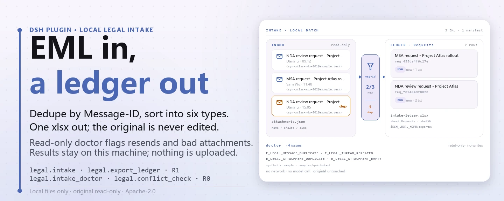
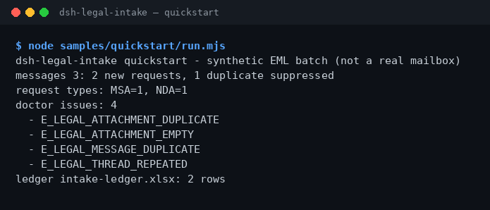

<div align="center">

<picture>
  <source media="(prefers-color-scheme: dark)" srcset="docs/assets/dsh-legal-intake-hero-en-dark.webp">
  
</picture>

# dsh-legal-intake

**Turn a pile of legal-request emails into a reviewable local ledger — deduplicated by thread, with no network and no model call.**

A local legal-request intake plugin for DeepSeek Harness: parse EML, classify the request type, deduplicate by Message-ID / thread, and export an Excel ledger. Originals are read-only and every result stays on your machine.

[Install](#three-step-setup) · [Configuration](#configuration) · [FAQ](#faq) · [简体中文](README.md) · [English](README.en.md) · [Español](README.es.md) · [Português](README.pt.md) · [हिन्दी](README.hi.md)

[](LICENSE)
[](#compatibility)
[](https://www.npmjs.com/package/dsh-legal-intake)
[](https://github.com/PerryLink/dsh-legal-intake/actions/workflows/ci.yml)
[](#compatibility)

[](https://github.com/PerryLink/dsh-legal-intake/stargazers)
[](https://www.npmjs.com/package/dsh-legal-intake)
[](https://dshfind.com/plugins/PerryLink/dsh-legal-intake?ref=badge)
[](https://dsh.market/)
[](https://gitee.com/perrylink/dsh-plugins)

```sh
dsh plugin --profile <profile> add dsh-legal-intake
```

</div>

<sub>Community plugin, not affiliated with DeepSeek. Canonical repository: <https://github.com/PerryLink/dsh-legal-intake> (same-name repositories under other accounts are not affiliated; Gitee is an aggregate mirror). Status: alpha · verified on public/synthetic data only · not GA — no customer data or customer evidence, no production-readiness claim.</sub>

## What it is

Collect legal-request EML emails, deduplicate by thread, classify the request type, and export an Excel ledger. The plugin works only on your machine: you (or the session) hand EML text plus an attachment manifest to `legal.intake`, which parses the headers, deduplicates by `Message-ID`, classifies the request into `NDA` / `MSA` / `CONTRACT_REVIEW` / `DISPUTE` / `COMPLIANCE` / `OTHER` with keywords, and writes each request into the local `legal` storage domain; `legal.export_ledger` then exports that table to `$DSH_HOME/storages/dsh-legal-intake/exports/intake-ledger.xlsx`. No mailbox connection, no network, no model call, and the original EML and attachment manifest are never modified.

- **Good fit**: a few dozen EML legal requests from clients or suppliers that must be deduplicated by Message-ID / thread and turned into a ledger a colleague can review.
- **Not a fit**: automatically reading a mailbox, or producing legal opinions and approval decisions for you; the package only reads the files you hand it.

<picture>
  <source media="(prefers-color-scheme: dark)" srcset="docs/assets/dsh-legal-intake-flow-v5-dark.svg">
  
</picture>

## Three-step setup

1. **Install** (pick one channel):

   ```sh
   # npm channel (recommended; published releases)
   dsh plugin --profile <profile> add dsh-legal-intake
   # git channel (latest main; equivalent to git+https://github.com/PerryLink/dsh-legal-intake.git)
   dsh plugin --profile <profile> add github:PerryLink/dsh-legal-intake
   # tarball channel: pnpm pack in this repo, then
   dsh plugin --profile <profile> add ./dsh-legal-intake-<version>.tgz
   ```

   npm is recommended; the other channels are for pinning or offline installs.

2. **Minimal config**: there are no plugin-level config keys — `cordis.patch.yml` only `insert`s one row, and the defaults work. Only environment variables may need adjusting (see "Configuration").

   ```yaml
   - insert:
       - id: dsh-legal-intake
         name: dsh-legal-intake
   ```

3. **Verify it mounts**:

   ```sh
   dsh --profile <profile> --dump-config | grep dsh-legal-intake
   node samples/quickstart/run.mjs
   ```

   The quickstart reads the three synthetic EMLs and one attachment manifest shipped with the package and calls `legal.intake_doctor → legal.intake → legal.export_ledger` in order. Inside a session you can also just ask — this is a translation of the demo prompt shipped in `package.json` as `dsh.demo.prompt`:

   > I have a legal-request email from a client plus the attachment manifest — deduplicate by thread, classify the request type, and export a ledger.

   It should end with:

```text
dsh-legal-intake quickstart - synthetic EML batch (not a real mailbox)
messages 3: 2 new requests, 1 duplicate suppressed
request types: MSA=1, NDA=1
doctor issues: 4
  - E_LEGAL_ATTACHMENT_DUPLICATE
  - E_LEGAL_ATTACHMENT_EMPTY
  - E_LEGAL_MESSAGE_DUPLICATE
  - E_LEGAL_THREAD_REPEATED
ledger intake-ledger.xlsx: 2 rows
```

**Uninstall**: `dsh plugin --profile <profile> remove dsh-legal-intake` (or remove the row from the profile patch).

<details>
<summary>Install from the DSH Desktop market</summary>

Every PerryLink plugin is listed in the built-in DSH Desktop market: **Market → Sources → Add source → paste** `https://perrylink-dsh-catalog.perrylink.workers.dev/catalog-source.json` **→ select**. Installation still requires the market's npm identity check and your confirmation.

</details>

## Core capabilities

- **Local EML intake** — `legal.intake` takes a batch of EML texts plus attachment metadata, parses `Subject` / `From` / `Date` / `Message-ID` / `Thread-Id`, deduplicates by `Message-ID`, and writes new requests into the `requests` table of the local `legal` storage domain; a duplicate email is only counted as a duplicate and creates no new row.
- **Request-type classification** — classifies by keywords in the subject and body into `NDA` / `MSA` / `CONTRACT_REVIEW` / `DISPUTE` / `COMPLIANCE` / `OTHER`; first match wins and anything unmatched becomes `OTHER`.
- **Pre-intake QA** — `legal.intake_doctor` checks a batch read-only for missing headers, duplicate `Message-ID`, repeated `Thread-Id`, duplicate / empty attachment names, and zero-byte attachments, reporting stable error codes without throwing or storing anything.
- **Party conflict pre-check** — `legal.conflict_check` normalizes party names, checks whether the same party sits on opposing sides between a new matter and existing matters, and flags a party listed on both sides of the new matter; read-only, and not a substitute for a formal conflicts search.
- **Ledger export** — `legal.export_ledger` exports the `requests` table to `intake-ledger.xlsx` (sheet `Requests`) and returns the path, row count, and file SHA-256.
- **Purely local** — no `fetch` / HTTP / DNS / WebSocket calls in the source; no mailbox, OA or cloud connection, no upload.
- **Readable failures** — every error is `<plain-language sentence> (E_LEGAL_…) | next step: <one action>`, so you can act on it directly.

### Tool surface

Tool names are a stable API (matched to runtime output, kept in English); descriptions are localized. Writing tools are marked **R1 (local write)**, read-only tools **R0**.

| Tool | Purpose | Risk |
|---|---|---|
| `legal.intake` | Parse EML, classify the request, dedupe by Message-ID and write `requests`; returns new-request ids and duplicate ids | R1 local write |
| `legal.export_ledger` | Export `requests` as the `Requests` sheet; returns path, rows and SHA-256 | R1 local write |
| `legal.intake_doctor` | Pre-intake QA: missing headers, duplicate Message-ID / thread, duplicate / empty / zero-byte attachments | R0 read-only |
| `legal.conflict_check` | Party conflict pre-check between a new matter and existing matters: normalized names, opposing sides, both-sides party | R0 read-only |

### Input and output

Input:

- EML text (UTF-8): at least `Subject` and `From`; `Date`, `Message-ID` and `Thread-Id` are optional. A missing `Subject` or `From` raises `E_LEGAL_EML_INVALID`; a missing `Message-ID` falls back to a content hash `mid-…`, and a missing `Thread-Id` falls back to `Message-ID`.
- Attachment manifest JSON: each entry carries only `name` / `sha256` / `size` metadata; attachment contents are never read.
- Shipped samples in `samples/quickstart/input/`: 3 synthetic EMLs + 1 attachment manifest, far below 500 KB, included in the npm package.
- There is no hard file limit; for human review we suggest at most 50 emails and 200 manifest rows per batch.

Output:

- A terminal summary: how many messages were read, how many new requests, how many duplicates were skipped, and how many QA issues were found.
- The ledger: `$DSH_HOME/storages/dsh-legal-intake/exports/intake-ledger.xlsx`, sheet `Requests`, one row per request (`request_id`, `subject`, `from`, `received_at`, `type`, `status`, `attachments`).
- Request records are also written to the `requests` table of the local `legal` storage domain; `request_id` is `req_` plus the first 12 hex characters of the SHA-256 of `Message-ID`.
- The original EML and attachment manifest are never modified.

### Examples

Paste this line (translated from the demo prompt shipped in `package.json` as `dsh.demo.prompt`):

```text
I have a legal-request email from a client plus the attachment manifest — deduplicate by thread, classify the request type, and export a ledger.
```

Or run it yourself (a real run — the screenshot comes from this command):

```sh
node samples/quickstart/run.mjs
```



*Synthetic EML → gold file `samples/quickstart/expected/result.json`; the command and hashes are recorded in `screenshots.json`.*

`--check` recomputes the run and compares every field against the gold file, ending with `quickstart ok`: 3 synthetic EMLs produce 2 new requests, 1 duplicate, 4 QA issues and 2 ledger rows.

*Observed from `samples/quickstart/expected/result.json` (= the stdout of `node samples/quickstart/run.mjs --json`); assertions live in `test/quickstart.test.mjs`.*

### Fixture-backed example

Input: [`fixtures/public/mit/sample_nda.txt`](https://github.com/PerryLink/dsh-legal-intake/blob/main/fixtures/public/mit/sample_nda.txt) (public MIT NDA sample, wrapped in an EML envelope and exercised by `test/public-nda-intake.test.mjs`; classified as `NDA`).

Command: `pnpm test`

Acceptance row (the `SKU-09-A01` row of `ACCEPTANCE.csv`; the full seven rows are in "Measured data"):

```csv
req_id,metric,threshold,actual,pass,source,counted
SKU-09-A01,邮件入库（50）,50/50,50,true,public/synthetic,false
```

*This is a fixture-backed acceptance row, not a customer run; no output is invented.*

## Measured data

The public/synthetic acceptance suite is reproduced with `scripts/acceptance.mjs`; details live in `ACCEPTANCE.csv`. These are its seven rows, quoted verbatim (the full file also carries `script` and `evidence_sha256`):

```csv
req_id,metric,threshold,actual,pass,source,counted
SKU-09-A01,邮件入库（50）,50/50,50,true,public/synthetic,false
SKU-09-A02,线程/Message-ID 去重,5/5,5,true,public/synthetic,false
SKU-09-A03,台账行,50,50,true,public/synthetic,false
SKU-09-A04,台账 sheet,1,1,true,public/synthetic,false
SKU-09-A05,入库前 EML 体检,2,2,true,public/synthetic,false
SKU-09-A06,冲突预检,1,1,true,public/synthetic,false
PS1-QS01,quickstart 样例与金标一致,1/1,1,true,synthetic/quickstart,true
```

`PS1-QS01` is a local reproduction of the shipped sample (`counted=true`); the other SKU rows are public/synthetic fixture checks (`counted=false`). `EVIDENCE.md` records the same synthetic batch: 0 real mailboxes, 50 synthetic EMLs + 5 resent messages. None of this is a customer run, and no output is invented.

Public samples: `samples/quickstart/` ships with the npm package and `node samples/quickstart/run.mjs --check` reproduces its gold file; `fixtures/` is repository-only (including the MIT NDA sample above) and is not part of the npm tarball.

## Configuration

This plugin has no Schemastery config keys: `cordis.patch.yml` only `insert`s one row (`id: dsh-legal-intake`), and the defaults work. What you can tune is two environment variables and the tool arguments.

| Variable | Default | Meaning |
|---|---|---|
| `DSH_LEGAL_HOME` | `$DSH_HOME/storages/dsh-legal-intake` | Base directory for local storage and exports; without `DSH_HOME` it falls back to `storages/dsh-legal-intake` under the host process cwd |
| `DSH_HOME` | host default | Parent directory of the path above; point it at a temporary directory in tests so nothing lands in a real profile |

The most-used tool arguments:

| Parameter | Default | Applies to | Meaning |
|---|---|---|---|
| `messages[].eml_text` | required | `legal.intake` / `legal.intake_doctor` | Full UTF-8 EML text; must contain `Subject` and `From` |
| `messages[].attachments[]` | `[]` | `legal.intake` / `legal.intake_doctor` | Attachment metadata `name` / `sha256` / `size`; contents are not read |
| `new_parties[]` | required | `legal.conflict_check` | New-matter parties: `name` + `role` (`client` / `adverse`) |
| `existing[]` | required | `legal.conflict_check` | Existing matters: `matter_id` + `parties[]` (also `name` / `role`) |

<details>
<summary>Error codes and troubleshooting</summary>

Every error reads `<plain-language sentence> (E_LEGAL_…) | next step: <one action>`. Common codes:

| Code | When it appears | Next step |
|---|---|---|
| `E_LEGAL_EML_INVALID` | The email lacks `Subject` or `From` (thrown) | Add both headers, or start with the shipped sample |
| `E_LEGAL_LEDGER_FAILED` | The ledger cannot be written (`legal.export_ledger` throws) | Check that the export directory is writable, then re-run the export |
| `E_LEGAL_MESSAGE_DUPLICATE` | QA finds a duplicate `Message-ID` (treated as a resend) | Confirm it is a resend; for a new request ask the sender for a new email |
| `E_LEGAL_THREAD_REPEATED` | QA finds two different emails sharing one `Thread-Id` | Check the thread id; unrelated email chains need their own ids |
| `E_LEGAL_ATTACHMENT_NAME_EMPTY` | A manifest entry has no file name | Add the name, or delete the entry |
| `E_LEGAL_ATTACHMENT_DUPLICATE` | One email has two attachments with the same name | Give them different names, or drop the duplicate |
| `E_LEGAL_ATTACHMENT_EMPTY` | A manifest entry is a zero-byte attachment | Re-upload it, or remove it from the manifest |
| `E_LEGAL_PARTY_BOTH_SIDES` | One party is both client and adverse in the new matter | Confirm the role and keep one side before re-running |

Symptom / cause / action steps are in [`TROUBLESHOOTING.md`](TROUBLESHOOTING.md).

</details>

## FAQ

<details>
<summary>It will not install — what now?</summary>

Check DSH `>=0.2.1-rc.3 <0.4.0` and Node `>=24.9 <25`, then retry with a fresh `DSH_HOME`; full steps are in [`TROUBLESHOOTING.md`](TROUBLESHOOTING.md).

</details>

<details>
<summary>Why does the same email enter only once?</summary>

Deduplication is by `Message-ID`, so a resent email is counted as a duplicate instead of a new request; `legal.intake_doctor` additionally reports duplicate `Message-ID`s and repeated `Thread-Id`s. Note: two emails with the same `Thread-Id` but different `Message-ID`s are not deduplicated — QA only reports `E_LEGAL_THREAD_REPEATED`.

</details>

<details>
<summary>What happens when the attachment manifest does not line up?</summary>

QA reports `E_LEGAL_ATTACHMENT_DUPLICATE` (same name) and `E_LEGAL_ATTACHMENT_EMPTY` (zero bytes); fix the manifest as suggested — the original attachments are untouched.

</details>

<details>
<summary>Can it process my real emails?</summary>

It runs locally, but the package is alpha and verified only on public/synthetic data; it is not a legal opinion. Sanitize real email before use and keep a human reviewer.

</details>

<details>
<summary>Does it go online or upload email?</summary>

No. Parsing, deduplication and ledger export all happen on your machine; the source has no HTTP / DNS / WebSocket calls, and the demo metadata in `package.json` declares `network: false`.

</details>

## Security boundaries

- **No network, no model call.** The source contains no `fetch` / HTTP / DNS / WebSocket calls; the demo metadata in `package.json` declares `network: false`. Input and output stay local.
- **Read-only input.** The tools receive EML text and a manifest JSON, read no other directory and never rewrite an original; attachments contribute only `name` / `sha256` / `size` metadata, never their contents.
- **Bounded writes.** Writes land only under `$DSH_LEGAL_HOME` (default `$DSH_HOME/storages/dsh-legal-intake`) in `exports/` and in the `requests` table of the local `legal` storage domain.
- **Duplicate protection.** When a `Message-ID` already exists in the `requests` table, `legal.intake` only counts it as a duplicate — no new row, no overwrite.
- **Loud failures.** Missing headers and export failures raise coded errors; QA and the conflict pre-check return stable codes instead of silently skipping.
- **No hidden surface.** No mailbox / OA / cloud connection, and no command, client slot, `webServer` route or service key; the host mounts only the `tools` and `storageDomain` services, with no R2/R3 tools.

## Permissions & data

- **Reads**: the EML text and attachment manifest you point at (read by the session and passed in as arguments); no other directories.
- **Writes**: `$DSH_HOME/storages/dsh-legal-intake` (`exports/intake-ledger.xlsx`) and the local `legal` storage domain; original files untouched.
- **Network**: no (no HTTP / DNS / WebSocket calls in the source).
- **External systems**: none (no mailbox, OA or cloud service; no uploads).
- **Data boundary**: verified on public/synthetic samples only; no customer data, no customer evidence.

Writing tools are marked **R1 (local write)**, read-only tools **R0**; see "Tool surface".

## Known limitations

- **Verified on public/synthetic data only.** Every acceptance row comes from a public or synthetic fixture (`counted=false` for the SKU rows in `ACCEPTANCE.csv`; `PS1-QS01` is a local sample reproduction with `counted=true`); no customer data or customer evidence.
- **Alpha / partial / not counted / not GA.** No production-readiness claim, and no legal opinion, approval or transaction conclusion.
- **No automatic mail retrieval.** It connects to no mailbox, OA or cloud service; EML text and the attachment manifest must be supplied by you (or the session).
- **Metadata-only attachments.** It parses no docx / pdf or other attachment content; duplicate, empty and zero-byte attachments are reported as QA issues only.
- **Lightweight EML header parsing.** Only `Subject` / `From` are required; MIME multipart decoding is unsupported and the body is treated as plain text. A missing `Message-ID` falls back to a content hash, and a missing `Thread-Id` falls back to `Message-ID`.
- **Keyword-heuristic classification.** It tries `NDA` → `MSA` → review → dispute → compliance in order and takes the first match, defaulting to `OTHER`; misclassification is possible.
- **Deduplication is by `Message-ID` only.** A new email in the same thread with a different `Message-ID` is not deduplicated; QA only reports `E_LEGAL_THREAD_REPEATED`.
- **Storage is JSON KV.** The `legal` domain (version 1) has a single `requests` table with no foreign keys, cross-table transactions or migrations; `request_id` is derived from the first 12 hex characters of the `Message-ID` hash.
- **No client UI.** The package is host-only and registers no slot or client package; everything goes through the tool surface.
- **Exact boundaries.** Per-tool boundaries are exactly the "Tool surface" table plus `ACCEPTANCE.csv`.

## Interoperability with other DSH plugins

- **Namespaced tool names.** Every tool lives under `legal.*` and does not take a bare name used by built-in tools or another plugin.
- **No host surface stealing.** It registers no command, client slot, `webServer` route or service key; it only injects the `tools` and `storageDomain` host services.
- **Independent storage domain.** It uses only one domain, `legal` (version 1); teardown is a Cordis effect, so stopping or hot-reloading the plugin undoes it.
- **Complementary responsibilities.** Clause review belongs to [`dsh-legal-clause`](https://github.com/PerryLink/dsh-legal-clause) and the full contract workflow to [`dsh-contract-suite`](https://github.com/PerryLink/dsh-contract-suite); clause stance and evidence lists belong to [`dsh-contract-stance`](https://github.com/PerryLink/dsh-contract-stance) and [`dsh-evidence-check`](https://github.com/PerryLink/dsh-evidence-check). Each is a separate package, installed only when needed.

## Compatibility

| Surface | Status |
|---|---|
| Harness | DeepSeek Harness `>=0.2.1-rc.3 <0.4.0` (`engines.dsh` in `package.json`) |
| Node | `>=24.9.0 <25` (`.nvmrc`: 24) |
| Platforms | Anywhere DSH runs; local files only |
| Data | No network, no model call, no upload |

## Ecosystem & quality

- [Gitee aggregate mirror](https://gitee.com/perrylink/dsh-plugins) (many plugins archived together; GitHub is canonical)
- [dshfind plugin page](https://dshfind.com/plugins/PerryLink/dsh-legal-intake) (installs and ranking)
- [DSH Market](https://dsh.market/) (listed)
- **1024 store channel**: `npm i -g dsh1024` once, then `dsh1024 plugin --profile <profile> add dsh-legal-intake` (counts toward the [deepseek1024.com](https://deepseek1024.com) install ranking)
- Docs: [`TROUBLESHOOTING.md`](TROUBLESHOOTING.md) · [`PRIVACY.md`](PRIVACY.md) · [`SECURITY.md`](SECURITY.md) · [`CONTRIBUTING.md`](CONTRIBUTING.md) · [`CHANGELOG.md`](CHANGELOG.md)
- Indexes: [Domain index](https://perrylink.github.io/dsh-plugins/) · [Checker family](https://perrylink.github.io/zh/checkers/) · [Mainline family](https://github.com/PerryLink/dsh-kit)

### Related work and checkers

Sibling packages and family indexes: [dsh-legal-clause](https://github.com/PerryLink/dsh-legal-clause) · [dsh-contract-suite](https://github.com/PerryLink/dsh-contract-suite)

Each checker is a separate package with its own rule pack and version; install only the ones you need:

| Package | Why it is relevant |
|---|---|
| [`dsh-contract-stance`](https://github.com/PerryLink/dsh-contract-stance) | Clause stance register once an intake becomes a contract review |
| [`dsh-evidence-check`](https://github.com/PerryLink/dsh-evidence-check) | Evidence-list completeness when the request becomes a dispute |

## Development

```sh
pnpm install --frozen-lockfile
pnpm build && pnpm lint && pnpm typecheck && pnpm test   # tsc build + node --test (6 files / 13 cases)
pnpm gate:sku09                                          # acceptance gate (ACCEPTANCE.csv)
node scripts/acceptance.mjs                              # re-run public/synthetic acceptance
node samples/quickstart/run.mjs                          # synthetic sample summary
node samples/quickstart/run.mjs --check                  # compare field by field with the gold file
```

| Path | Contents |
|---|---|
| `src/core/` | EML parsing, request classification and error wording (`parseEml` / `classify` / `intakeErrorMessage`) |
| `src/plugin/` | Host face: `index.ts` registers the tools, `storage.ts` defines the `legal` domain, `tools.ts` holds the four tools |
| `lib/` | `tsc` build output, i.e. the npm payload |
| `samples/quickstart/` | Shipped synthetic sample + gold file `expected/result.json` |
| `fixtures/` | Repository-only public fixtures (the MIT NDA sample; not in the npm tarball) |
| `scripts/` | Build / verification / acceptance scripts and the README asset generator |
| `test/` | `node --test` (6 files / 13 cases) |

TypeScript sources live in `src/`, build output in `lib/`. Current repository version `0.1.0` (matches `package.json`); `node --test test/*.test.mjs` is green (6 files / 13 cases, 0 failures). The README pictures are generated programmatically by [`scripts/gen-readme-assets.py`](scripts/gen-readme-assets.py) — the hero banner with Pillow (four files, zh/en × light/dark), the structure diagram as hand-written SVG (flow-v5 light and dark) — and are safe to re-run; the older single-skin `dsh-legal-intake-flow-{light,dark}.svg` and the terminal captures stay in `docs/assets/` for existing links, while the READMEs reference only the new images.

Topics: `deepseek-harness`, `dsh`, `dsh-plugin`, `legal`, `intake`, `contract`, `perrylink`, `eml`

## Family & thanks

This project is part of the DeepSeek Harness plugin family from [PerryLink](https://github.com/PerryLink) (all Apache-2.0). If it is useful, **a star helps the next person find it** — nothing is gated behind it.

- [@PerryLink](https://github.com/PerryLink) — creator and maintainer: EML parsing and thread dedupe, request classification, pre-intake QA, party conflict pre-check, ledger export, the quickstart and acceptance suite, and the five-language docs.
- Domain- and mainline-family indexes: [Domain index](https://perrylink.github.io/dsh-plugins/) · [Mainline family](https://github.com/PerryLink/dsh-kit).

## License

[LICENSE](LICENSE) (Apache License 2.0) © 2026 dsh-legal-intake contributors; see also `NOTICE` and `THIRD-PARTY-NOTICES`.

<p align="center"><sub>Apache-2.0 · Community plugin, not affiliated with DeepSeek.</sub></p>
