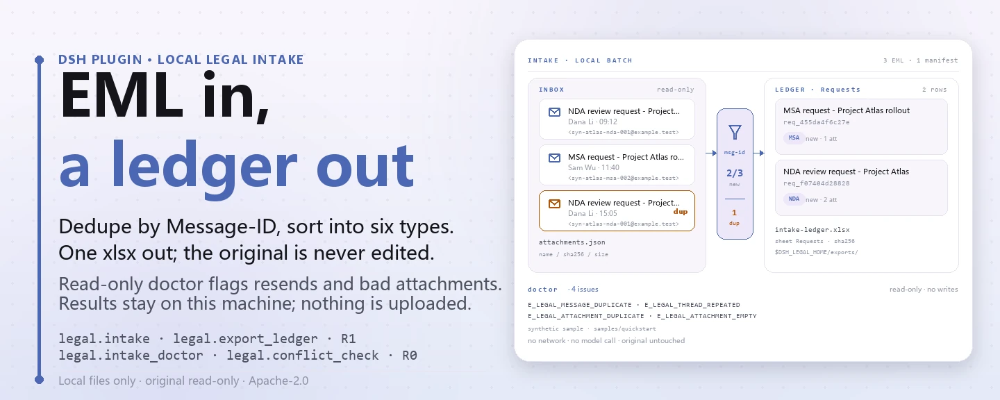
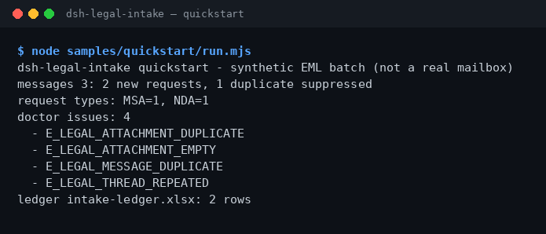

<div align="center">

<picture>
  <source media="(prefers-color-scheme: dark)" srcset="docs/assets/dsh-legal-intake-hero-en-dark.webp">
  
</picture>

# dsh-legal-intake

**Convierte un montón de correos de solicitudes legales en un registro local revisable — deduplicado por hilo, sin red y sin llamar a un modelo.**

Un plugin local de recepción de solicitudes legales para DeepSeek Harness: parsea EML, clasifica el tipo de solicitud, deduplica por Message-ID / hilo y exporta un registro Excel. Los originales son de solo lectura y todo el resultado se queda en tu máquina.

[Instalar](#instalación-en-tres-pasos) · [Configuración](#configuración) · [FAQ](#faq) · [简体中文](README.md) · [English](README.en.md) · [Español](README.es.md) · [Português](README.pt.md) · [हिन्दी](README.hi.md)

[](LICENSE)
[](#compatibilidad)
[](https://www.npmjs.com/package/dsh-legal-intake)
[](https://github.com/PerryLink/dsh-legal-intake/actions/workflows/ci.yml)
[](#compatibilidad)

[](https://github.com/PerryLink/dsh-legal-intake/stargazers)
[](https://www.npmjs.com/package/dsh-legal-intake)
[](https://dshfind.com/plugins/PerryLink/dsh-legal-intake?ref=badge)
[](https://dsh.market/)
[](https://gitee.com/perrylink/dsh-plugins)

```sh
dsh plugin --profile <profile> add dsh-legal-intake
```

</div>

<sub>Plugin de la comunidad, no afiliado a DeepSeek. Repositorio canónico: <https://github.com/PerryLink/dsh-legal-intake> (los repositorios con el mismo nombre en otras cuentas no están afiliados; Gitee es un espejo agregado). Estado: alpha · verificado solo con datos públicos/sintéticos · no GA — sin datos ni evidencia de clientes, sin promesa de producción.</sub>

## Qué es

Recibe correos EML con solicitudes legales, los deduplica por hilo, clasifica el tipo de solicitud y exporta un registro Excel. El plugin trabaja solo en tu máquina: tú (o la sesión) entregas el texto EML y el manifiesto de adjuntos a `legal_intake`, que parsea las cabeceras, deduplica por `Message-ID`, clasifica la solicitud en `NDA` / `MSA` / `CONTRACT_REVIEW` / `DISPUTE` / `COMPLIANCE` / `OTHER` mediante palabras clave y escribe cada solicitud en el dominio de almacenamiento local `legal`; después `legal_export_ledger` exporta esa tabla a `$DSH_HOME/storages/dsh-legal-intake/exports/intake-ledger.xlsx`. Sin conexión al buzón, sin red, sin llamada a modelo, y el EML y el manifiesto originales nunca se modifican.

- **Encaja**: unas decenas de EML con solicitudes legales de clientes o proveedores que deben deduplicarse por Message-ID / hilo y convertirse en un registro que un colega pueda revisar.
- **No encaja**: leer un buzón automáticamente o emitir opiniones legales y decisiones de aprobación por ti; el paquete solo lee los archivos que le entregas.

<picture>
  <source media="(prefers-color-scheme: dark)" srcset="docs/assets/dsh-legal-intake-flow-v5-dark.svg">
  
</picture>

## Instalación en tres pasos

1. **Instala** (elige un canal):

   ```sh
   # canal npm (recomendado; versiones publicadas)
   dsh plugin --profile <profile> add dsh-legal-intake
   # canal git (último main; equivalente a git+https://github.com/PerryLink/dsh-legal-intake.git)
   dsh plugin --profile <profile> add github:PerryLink/dsh-legal-intake
   # canal tarball: pnpm pack en este repo y luego
   dsh plugin --profile <profile> add ./dsh-legal-intake-<version>.tgz
   ```

   Se recomienda npm; los demás canales sirven para fijar versión o instalar sin conexión.

2. **Configuración mínima**: no hay claves de configuración del plugin — `cordis.patch.yml` solo `insert`a una fila y los valores por defecto funcionan. Solo pueden necesitar ajuste las variables de entorno (ver «Configuración»).

   ```yaml
   - insert:
       - id: dsh-legal-intake
         name: dsh-legal-intake
   ```

3. **Verifica que se monta**:

   ```sh
   dsh --profile <profile> --dump-config | grep dsh-legal-intake
   node samples/quickstart/run.mjs
   ```

   El quickstart lee los tres EML sintéticos y el manifiesto de adjuntos incluidos en el paquete y llama en orden a `legal_intake_doctor → legal_intake → legal_export_ledger`. Dentro de una sesión también puedes pedirlo directamente (traducción del prompt de demostración de `package.json`, `dsh.demo.prompt`):

   > Tengo un correo de solicitud legal de un cliente y el manifiesto de adjuntos: deduplica por hilo, clasifica el tipo de solicitud y exporta un registro.

   La salida debe terminar así:

```text
dsh-legal-intake quickstart - synthetic EML batch (not a real mailbox)
messages 3: 2 new requests, 1 duplicate suppressed
request types: MSA=1, NDA=1
doctor issues: 4
  - E_LEGAL_ATTACHMENT_DUPLICATE
  - E_LEGAL_ATTACHMENT_EMPTY
  - E_LEGAL_MESSAGE_DUPLICATE
  - E_LEGAL_THREAD_REPEATED
ledger intake-ledger.xlsx: 2 rows
```

**Desinstalar**: `dsh plugin --profile <profile> remove dsh-legal-intake` (o elimina la fila del profile patch).

<details>
<summary>Instalar desde el mercado de DSH Desktop</summary>

Todos los plugins de PerryLink están en el mercado integrado de DSH Desktop: **Mercado → Fuentes → Añadir fuente → pegar** `https://perrylink-dsh-catalog.perrylink.workers.dev/catalog-source.json` **→ seleccionar**. La instalación sigue requiriendo la comprobación de identidad npm del mercado y tu confirmación.

</details>

## Capacidades principales

- **Recepción local de EML** — `legal_intake` recibe un lote de textos EML y metadatos de adjuntos, parsea `Subject` / `From` / `Date` / `Message-ID` / `Thread-Id`, deduplica por `Message-ID` y escribe las solicitudes nuevas en la tabla `requests` del dominio local `legal`; un correo repetido solo cuenta como duplicado y no crea una fila nueva.
- **Clasificación del tipo de solicitud** — clasifica por palabras clave del asunto y el cuerpo en `NDA` / `MSA` / `CONTRACT_REVIEW` / `DISPUTE` / `COMPLIANCE` / `OTHER`; gana la primera coincidencia y lo no reconocido cae en `OTHER`.
- **Control previo** — `legal_intake_doctor` revisa un lote en solo lectura: cabeceras ausentes, `Message-ID` duplicado, `Thread-Id` repetido, nombres de adjunto duplicados o vacíos y adjuntos de 0 bytes; devuelve códigos estables sin lanzar excepciones ni guardar nada.
- **Precomprobación de conflictos** — `legal_conflict_check` normaliza los nombres de las partes, comprueba si una misma parte queda en lados opuestos entre un asunto nuevo y asuntos existentes y avisa si una parte aparece en ambos lados del asunto nuevo; es de solo lectura y no sustituye una búsqueda formal de conflictos.
- **Exportación del registro** — `legal_export_ledger` exporta la tabla `requests` a `intake-ledger.xlsx` (hoja `Requests`) y devuelve la ruta, el número de filas y el SHA-256 del archivo.
- **Totalmente local** — sin llamadas `fetch` / HTTP / DNS / WebSocket en el código; no se conecta a buzones, OA ni servicios en la nube, y no sube datos.
- **Errores legibles** — todo error es `<frase llana> (E_LEGAL_…) | siguiente paso: <una acción>`, para que puedas actuar directamente.

### Superficie de herramientas

Los nombres de las herramientas son una API estable (coinciden con la salida del runtime y se mantienen en inglés); las descripciones están localizadas. Las herramientas que escriben se marcan **R1 (escritura local)** y las de solo lectura **R0**.

| Herramienta | Propósito | Riesgo |
|---|---|---|
| `legal_intake` | Parsea EML, clasifica la solicitud, deduplica por Message-ID y escribe `requests`; devuelve ids nuevos y duplicados | R1 escritura local |
| `legal_export_ledger` | Exporta `requests` como hoja `Requests`; devuelve ruta, filas y SHA-256 | R1 escritura local |
| `legal_intake_doctor` | Control previo: cabeceras ausentes, Message-ID / hilo duplicados, adjuntos duplicados / vacíos / de 0 bytes | R0 solo lectura |
| `legal_conflict_check` | Precomprobación de conflictos entre un asunto nuevo y asuntos existentes: nombres normalizados, lados opuestos, parte en ambos lados | R0 solo lectura |

### Entrada y salida

Entrada:

- Texto EML (UTF-8): como mínimo `Subject` y `From`; `Date`, `Message-ID` y `Thread-Id` son opcionales. Si falta `Subject` o `From` se lanza `E_LEGAL_EML_INVALID`; si falta `Message-ID` se usa un hash del contenido como `mid-…`, y si falta `Thread-Id` se usa `Message-ID`.
- Manifiesto de adjuntos JSON: cada entrada lleva solo metadatos `name` / `sha256` / `size`; el contenido de los adjuntos nunca se lee.
- Muestras incluidas en `samples/quickstart/input/`: 3 EML sintéticos + 1 manifiesto de adjuntos, muy por debajo de 500 KB, incluidos en el paquete npm.
- No hay límite duro de archivos; para la revisión humana se recomienda como máximo 50 correos y 200 filas de manifiesto por lote.

Salida:

- Un resumen de terminal: cuántos mensajes se leyeron, cuántas solicitudes nuevas, cuántos duplicados se omitieron y cuántos problemas detectó el control previo.
- El registro: `$DSH_HOME/storages/dsh-legal-intake/exports/intake-ledger.xlsx`, hoja `Requests`, una fila por solicitud (`request_id`, `subject`, `from`, `received_at`, `type`, `status`, `attachments`).
- Los registros de solicitud también se escriben en la tabla `requests` del dominio local `legal`; `request_id` es `req_` más los primeros 12 caracteres hexadecimales del SHA-256 de `Message-ID`.
- El EML original y el manifiesto de adjuntos nunca se modifican.

### Ejemplos

Copia esta línea (traducción del prompt de demostración de `package.json`, `dsh.demo.prompt`):

```text
Tengo un correo de solicitud legal de un cliente y el manifiesto de adjuntos: deduplica por hilo, clasifica el tipo de solicitud y exporta un registro.
```

O ejecútalo tú mismo (ejecución real: la captura viene de este comando):

```sh
node samples/quickstart/run.mjs
```



*EML sintéticos → archivo de referencia `samples/quickstart/expected/result.json`; el comando y los hashes están en `screenshots.json`.*

`--check` recalcula y compara campo por campo con el archivo de referencia, y termina con `quickstart ok`: 3 EML sintéticos producen 2 solicitudes nuevas, 1 duplicado, 4 problemas de control previo y 2 filas de registro.

*Observed from `samples/quickstart/expected/result.json` (= la salida de `node samples/quickstart/run.mjs --json`); las aserciones están en `test/quickstart.test.mjs`.*

### Ejemplo respaldado por fixture

Entrada: [`fixtures/public/mit/sample_nda.txt`](https://github.com/PerryLink/dsh-legal-intake/blob/main/fixtures/public/mit/sample_nda.txt) (muestra pública de NDA con licencia MIT, envuelta en un sobre EML y ejercitada por `test/public-nda-intake.test.mjs`; se clasifica como `NDA`).

Comando: `pnpm test`

Fila de aceptación (la fila `SKU-09-A01` de `ACCEPTANCE.csv`; las siete filas completas están en «Datos medidos»):

```csv
req_id,metric,threshold,actual,pass,source,counted
SKU-09-A01,邮件入库（50）,50/50,50,true,public/synthetic,false
```

*Es una fila de aceptación respaldada por fixture, no una ejecución de cliente; no se inventa salida.*

## Datos medidos

La suite de aceptación pública/sintética se reproduce con `scripts/acceptance.mjs`; el detalle está en `ACCEPTANCE.csv`. Estas son sus siete filas, citadas literalmente (el archivo completo también incluye `script` y `evidence_sha256`):

```csv
req_id,metric,threshold,actual,pass,source,counted
SKU-09-A01,邮件入库（50）,50/50,50,true,public/synthetic,false
SKU-09-A02,线程/Message-ID 去重,5/5,5,true,public/synthetic,false
SKU-09-A03,台账行,50,50,true,public/synthetic,false
SKU-09-A04,台账 sheet,1,1,true,public/synthetic,false
SKU-09-A05,入库前 EML 体检,2,2,true,public/synthetic,false
SKU-09-A06,冲突预检,1,1,true,public/synthetic,false
PS1-QS01,quickstart 样例与金标一致,1/1,1,true,synthetic/quickstart,true
```

`PS1-QS01` es una reproducción local de la muestra incluida (`counted=true`); las demás filas SKU son comprobaciones con fixtures públicas/sintéticas (`counted=false`). `EVIDENCE.md` registra el mismo lote sintético: 0 buzones reales, 50 EML sintéticos + 5 mensajes reenviados. Nada de esto es una ejecución de cliente y no se inventa salida.

Muestras públicas: `samples/quickstart/` se publica con el paquete npm y `node samples/quickstart/run.mjs --check` reproduce su archivo de referencia; `fixtures/` solo existe en el repositorio (incluida la muestra MIT NDA anterior) y no forma parte del tarball npm.

## Configuración

Este plugin no tiene claves de configuración Schemastery: `cordis.patch.yml` solo `insert`a una fila (`id: dsh-legal-intake`) y los valores por defecto funcionan. Lo que puedes ajustar son dos variables de entorno y los argumentos de las herramientas.

| Variable | Valor por defecto | Significado |
|---|---|---|
| `DSH_LEGAL_HOME` | `$DSH_HOME/storages/dsh-legal-intake` | Directorio base del almacenamiento local y las exportaciones; sin `DSH_HOME` cae en `storages/dsh-legal-intake` bajo el cwd del proceso anfitrión |
| `DSH_HOME` | valor del host | Directorio padre de la ruta anterior; en pruebas apúntalo a un directorio temporal para no escribir en un perfil real |

Argumentos de herramienta más usados:

| Parámetro | Valor por defecto | Aplica a | Significado |
|---|---|---|---|
| `messages[].eml_text` | obligatorio | `legal_intake` / `legal_intake_doctor` | Texto EML completo en UTF-8; debe contener `Subject` y `From` |
| `messages[].attachments[]` | `[]` | `legal_intake` / `legal_intake_doctor` | Metadatos de adjunto `name` / `sha256` / `size`; el contenido no se lee |
| `new_parties[]` | obligatorio | `legal_conflict_check` | Partes del asunto nuevo: `name` + `role` (`client` / `adverse`) |
| `existing[]` | obligatorio | `legal_conflict_check` | Asuntos existentes: `matter_id` + `parties[]` (también `name` / `role`) |

<details>
<summary>Códigos de error y solución de problemas</summary>

Todo error se lee como `<frase llana> (E_LEGAL_…) | siguiente paso: <una acción>`. Códigos frecuentes:

| Código | Cuándo aparece | Siguiente paso |
|---|---|---|
| `E_LEGAL_EML_INVALID` | Al correo le falta `Subject` o `From` (se lanza) | Añade ambas cabeceras o empieza con la muestra incluida |
| `E_LEGAL_LEDGER_FAILED` | No se puede escribir el registro (`legal_export_ledger` lanza) | Comprueba que el directorio de exportación sea escribible y reintenta |
| `E_LEGAL_MESSAGE_DUPLICATE` | El control previo encuentra un `Message-ID` duplicado (se trata como reenvío) | Confirma si es un reenvío; para una solicitud nueva pide un correo nuevo |
| `E_LEGAL_THREAD_REPEATED` | Dos correos distintos comparten un `Thread-Id` | Revisa el id de hilo; cadenas no relacionadas necesitan ids propios |
| `E_LEGAL_ATTACHMENT_NAME_EMPTY` | Una entrada del manifiesto no tiene nombre de archivo | Añade el nombre o elimina la entrada |
| `E_LEGAL_ATTACHMENT_DUPLICATE` | Un correo tiene dos adjuntos con el mismo nombre | Ponles nombres distintos o elimina el duplicado |
| `E_LEGAL_ATTACHMENT_EMPTY` | Una entrada del manifiesto es un adjunto de 0 bytes | Vuelve a subirlo o quítalo del manifiesto |
| `E_LEGAL_PARTY_BOTH_SIDES` | Una parte es cliente y adversa a la vez en el asunto nuevo | Confirma el rol y deja un solo lado antes de repetir |

Los pasos por síntoma / causa / acción están en [`TROUBLESHOOTING.md`](TROUBLESHOOTING.md).

</details>

## FAQ

<details>
<summary>No se instala, ¿qué hago?</summary>

Comprueba que DSH sea `>=0.2.1-rc.3 <0.4.0` y Node `>=24.9 <25`, y reintenta con un `DSH_HOME` nuevo; los pasos completos están en [`TROUBLESHOOTING.md`](TROUBLESHOOTING.md).

</details>

<details>
<summary>¿Por qué el mismo correo entra solo una vez?</summary>

La deduplicación es por `Message-ID`, así que un correo reenviado cuenta como duplicado en lugar de como solicitud nueva; `legal_intake_doctor` además avisa de `Message-ID` duplicados y de `Thread-Id` repetidos. Ojo: dos correos con el mismo `Thread-Id` pero distinto `Message-ID` no se deduplican; el control previo solo informa `E_LEGAL_THREAD_REPEATED`.

</details>

<details>
<summary>¿Qué pasa si el manifiesto de adjuntos no cuadra?</summary>

El control previo devuelve `E_LEGAL_ATTACHMENT_DUPLICATE` (mismo nombre) y `E_LEGAL_ATTACHMENT_EMPTY` (0 bytes); corrige el manifiesto según la sugerencia — los adjuntos originales no se tocan.

</details>

<details>
<summary>¿Puede procesar mis correos reales?</summary>

Se ejecuta en local, pero el paquete es alpha y solo está verificado con datos públicos/sintéticos; no constituye una opinión legal. Anonimiza los correos reales antes de usarlos y mantén un revisor humano.

</details>

<details>
<summary>¿Se conecta a la red o sube correos?</summary>

No. El parseo, la deduplicación y la exportación del registro ocurren en tu máquina; el código no tiene llamadas HTTP / DNS / WebSocket y los metadatos de demostración de `package.json` declaran `network: false`.

</details>

## Límites de seguridad

- **Sin red ni llamada a modelo.** El código no contiene llamadas `fetch` / HTTP / DNS / WebSocket; los metadatos de demostración de `package.json` declaran `network: false`. Entrada y salida se quedan en local.
- **Entrada de solo lectura.** Las herramientas reciben texto EML y un JSON de manifiesto, no leen otros directorios y nunca reescriben un original; de los adjuntos solo usan metadatos `name` / `sha256` / `size`.
- **Escrituras acotadas.** Las escrituras solo caen bajo `$DSH_LEGAL_HOME` (por defecto `$DSH_HOME/storages/dsh-legal-intake`) en `exports/` y en la tabla `requests` del dominio local `legal`.
- **Protección contra duplicados.** Si un `Message-ID` ya existe en la tabla `requests`, `legal_intake` solo lo cuenta como duplicado: ni fila nueva ni sobrescritura.
- **Fallos ruidosos.** Las cabeceras ausentes y los fallos de exportación lanzan errores con código; el control previo y la precomprobación de conflictos devuelven códigos estables en lugar de omitir en silencio.
- **Sin superficie oculta.** Sin conexión a buzón / OA / nube y sin registrar comandos, slots de cliente, rutas `webServer` ni claves de servicio; el host solo monta `tools` y `storageDomain`, sin herramientas R2/R3.

## Permisos y datos

- **Lectura**: el texto EML y el manifiesto de adjuntos que indiques (los lee la sesión y los pasa como argumentos); ningún otro directorio.
- **Escritura**: `$DSH_HOME/storages/dsh-legal-intake` (`exports/intake-ledger.xlsx`) y el dominio local `legal`; los archivos originales no se tocan.
- **Red**: no (sin llamadas HTTP / DNS / WebSocket en el código).
- **Sistemas externos**: ninguno (sin buzón, OA ni servicio en la nube; sin subidas).
- **Frontera de datos**: solo muestras públicas/sintéticas; sin datos ni evidencia de clientes.

Las herramientas que escriben se marcan **R1 (escritura local)** y las de solo lectura **R0**; ver «Superficie de herramientas».

## Limitaciones conocidas

- **Solo verificado con datos públicos/sintéticos.** Todas las filas de aceptación vienen de fixtures públicas o sintéticas (`counted=false` en las filas SKU de `ACCEPTANCE.csv`; `PS1-QS01` es una reproducción local de la muestra con `counted=true`); sin datos ni evidencia de clientes.
- **Alpha / parcial / no contabilizado / no GA.** Sin promesa de producción ni conclusión legal, de aprobación o de transacción.
- **Sin lectura automática del buzón.** No se conecta a buzones, OA ni nube; el texto EML y el manifiesto deben aportarlos tú (o la sesión).
- **Adjuntos solo como metadatos.** No parsea contenido docx / pdf ni de otros adjuntos; los adjuntos duplicados, sin nombre o de 0 bytes solo se informan como problemas de control previo.
- **Parseo EML ligero.** Solo se exigen `Subject` / `From`; no hay decodificación MIME multipart y el cuerpo se trata como texto plano. Si falta `Message-ID` se usa un hash del contenido y si falta `Thread-Id` se usa `Message-ID`.
- **Clasificación por palabras clave.** Prueba `NDA` → `MSA` → revisión → disputa → cumplimiento en orden y toma la primera coincidencia, con `OTHER` por defecto; puede equivocarse.
- **Deduplicación solo por `Message-ID`.** Un correo nuevo del mismo hilo con otro `Message-ID` no se deduplica; el control previo solo informa `E_LEGAL_THREAD_REPEATED`.
- **Almacenamiento JSON KV.** El dominio `legal` (version 1) tiene una sola tabla `requests`, sin claves foráneas, transacciones entre tablas ni migraciones; `request_id` se deriva de los primeros 12 caracteres hexadecimales del hash de `Message-ID`.
- **Sin interfaz de cliente.** El paquete es solo host y no registra slots ni paquetes de cliente; todo pasa por la superficie de herramientas.
- **Límites exactos.** Los límites por herramienta son exactamente la tabla «Superficie de herramientas» más `ACCEPTANCE.csv`.

## Interoperabilidad con otros plugins de DSH

- **Nombres de herramienta con espacio de nombres.** Todas las herramientas están bajo `legal_*` y no ocupan nombres desnudos de herramientas integradas ni de otros plugins.
- **No ocupa superficies del host.** No registra comandos, slots de cliente, rutas `webServer` ni claves de servicio; solo inyecta los servicios `tools` y `storageDomain`.
- **Dominio de almacenamiento independiente.** Usa un único dominio, `legal` (version 1); el cierre es un effect de Cordis, así que detener o recargar el plugin lo deshace.
- **Responsabilidades complementarias.** La revisión de cláusulas corresponde a [`dsh-legal-clause`](https://github.com/PerryLink/dsh-legal-clause) y el flujo contractual completo a [`dsh-contract-suite`](https://github.com/PerryLink/dsh-contract-suite); la postura de cláusulas y las listas de evidencia, a [`dsh-contract-stance`](https://github.com/PerryLink/dsh-contract-stance) y [`dsh-evidence-check`](https://github.com/PerryLink/dsh-evidence-check). Cada uno es un paquete independiente que se instala solo si hace falta.

## Compatibilidad

| Superficie | Estado |
|---|---|
| Harness | DeepSeek Harness `>=0.2.1-rc.3 <0.4.0` (`engines.dsh` de `package.json`) |
| Node | `>=24.9.0 <25` (`.nvmrc`: 24) |
| Plataformas | Donde corra DSH; solo archivos locales |
| Datos | Sin red, sin llamada a modelo, sin subida |

## Ecosistema y calidad

- [Espejo agregado en Gitee](https://gitee.com/perrylink/dsh-plugins) (varios plugins archivados juntos; GitHub es la referencia)
- [Página del plugin en dshfind](https://dshfind.com/plugins/PerryLink/dsh-legal-intake) (instalaciones y ranking)
- [DSH Market](https://dsh.market/) (publicado)
- **Canal de la tienda 1024**: `npm i -g dsh1024` una vez y luego `dsh1024 plugin --profile <profile> add dsh-legal-intake` (cuenta para el ranking de instalaciones de [deepseek1024.com](https://deepseek1024.com))
- Documentación: [`TROUBLESHOOTING.md`](TROUBLESHOOTING.md) · [`PRIVACY.md`](PRIVACY.md) · [`SECURITY.md`](SECURITY.md) · [`CONTRIBUTING.md`](CONTRIBUTING.md) · [`CHANGELOG.md`](CHANGELOG.md)
- Índices: [Índice de dominio](https://perrylink.github.io/dsh-plugins/) · [Familia de checkers](https://perrylink.github.io/zh/checkers/) · [Familia principal](https://github.com/PerryLink/dsh-kit)

### Trabajo relacionado y verificadores

Paquetes hermanos e índices de familia: [dsh-legal-clause](https://github.com/PerryLink/dsh-legal-clause) · [dsh-contract-suite](https://github.com/PerryLink/dsh-contract-suite)

Cada verificador es un paquete independiente con su propio rule pack y versión; instala solo los que necesites:

| Paquete | Por qué es relevante |
|---|---|
| [`dsh-contract-stance`](https://github.com/PerryLink/dsh-contract-stance) | Registro de postura de cláusulas cuando la recepción pasa a revisión de contrato |
| [`dsh-evidence-check`](https://github.com/PerryLink/dsh-evidence-check) | Completitud de la lista de evidencia cuando la solicitud se convierte en disputa |

## Desarrollo

```sh
pnpm install --frozen-lockfile
pnpm build && pnpm lint && pnpm typecheck && pnpm test   # build tsc + node --test (7 archivos / 14 casos)
pnpm gate:sku09                                          # puerta de aceptación (ACCEPTANCE.csv)
node scripts/acceptance.mjs                              # repetir la aceptación pública/sintética
node samples/quickstart/run.mjs                          # resumen de la muestra sintética
node samples/quickstart/run.mjs --check                  # comparar campo por campo con el archivo de referencia
```

| Ruta | Contenido |
|---|---|
| `src/core/` | Parseo EML, clasificación de solicitudes y textos de error (`parseEml` / `classify` / `intakeErrorMessage`) |
| `src/plugin/` | Cara host: `index.ts` registra las herramientas, `storage.ts` define el dominio `legal`, `tools.ts` contiene las cuatro herramientas |
| `lib/` | Salida de `tsc`, es decir el contenido publicado en npm |
| `samples/quickstart/` | Muestra sintética incluida + archivo de referencia `expected/result.json` |
| `fixtures/` | Fixtures públicas solo del repositorio (la muestra MIT NDA; no están en el tarball npm) |
| `scripts/` | Scripts de build / verificación / aceptación y el generador de imágenes del README |
| `test/` | `node --test` (7 archivos / 14 casos) |

El código TypeScript está en `src/` y la salida de build en `lib/`. Versión actual del repositorio `0.2.0` (coincide con `package.json`); `node --test test/*.test.mjs` pasa en verde (7 archivos / 14 casos, 0 fallos). Las imágenes del README se generan programáticamente con [`scripts/gen-readme-assets.py`](scripts/gen-readme-assets.py) —el banner hero con Pillow (cuatro archivos, zh/en × claro/oscuro) y el diagrama de estructura como SVG escrito a mano (flow-v5 claro y oscuro)— y se pueden volver a ejecutar; el antiguo `dsh-legal-intake-flow-{light,dark}.svg` de una sola versión y las capturas de terminal se conservan en `docs/assets/` para los enlaces existentes, mientras que los README solo referencian las imágenes nuevas.

Topics: `deepseek-harness`, `dsh`, `dsh-plugin`, `legal`, `intake`, `contract`, `perrylink`, `eml`

## Familia y agradecimientos

Este proyecto forma parte de la familia de plugins de DeepSeek Harness de [PerryLink](https://github.com/PerryLink) (todos Apache-2.0). Si te resulta útil, **una estrella ayuda a que la siguiente persona lo encuentre** — nada está bloqueado tras ella.

- [@PerryLink](https://github.com/PerryLink) — creador y mantenedor: parseo EML y deduplicación por hilo, clasificación de solicitudes, control previo, precomprobación de conflictos, exportación del registro, la suite de quickstart y aceptación, y la documentación en cinco idiomas.
- Índices de familia de dominio y principal: [Índice de dominio](https://perrylink.github.io/dsh-plugins/) · [Familia principal](https://github.com/PerryLink/dsh-kit).

## Licencia

[LICENSE](LICENSE) (Apache License 2.0) © 2026 dsh-legal-intake contributors; ver también `NOTICE` y `THIRD-PARTY-NOTICES`.

<p align="center"><sub>Apache-2.0 · Plugin de la comunidad, no afiliado a DeepSeek.</sub></p>
