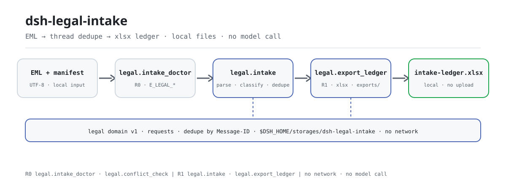
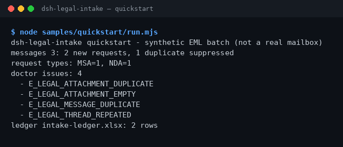

<div align="center">

<picture>
  <source media="(prefers-color-scheme: dark)" srcset="docs/assets/dsh-legal-intake-flow-dark.svg">
  
</picture>

# dsh-legal-intake

**कानूनी अनुरोधों के ढेरों ईमेल को समीक्षा-योग्य स्थानीय लेजर में बदलें — थ्रेड से डुप्लिकेट हटाकर, बिना नेटवर्क और बिना मॉडल कॉल।**

DeepSeek Harness के लिए स्थानीय कानूनी अनुरोध इनटेक प्लगइन: EML पार्स करें, अनुरोध का प्रकार तय करें, Message-ID / थ्रेड से डुप्लिकेट हटाएँ और Excel लेजर निर्यात करें। मूल फ़ाइलें केवल पढ़ने योग्य हैं और हर परिणाम आपकी मशीन पर ही रहता है।

[इंस्टॉल](#तीन-चरणों-में-शुरुआत) · [कॉन्फ़िगरेशन](#कॉन्फ़िगरेशन) · [FAQ](#faq) · [简体中文](README.md) · [English](README.en.md) · [Español](README.es.md) · [Português](README.pt.md) · [हिन्दी](README.hi.md)

[](LICENSE)
[](#संगतता)
[](https://www.npmjs.com/package/dsh-legal-intake)
[](https://github.com/PerryLink/dsh-legal-intake/actions/workflows/ci.yml)
[](#संगतता)

[](https://github.com/PerryLink/dsh-legal-intake/stargazers)
[](https://www.npmjs.com/package/dsh-legal-intake)
[](https://dshfind.com/plugins/PerryLink/dsh-legal-intake?ref=badge)
[](https://dsh.market/)
[](https://gitee.com/perrylink/dsh-plugins)

```sh
dsh plugin --profile <profile> add dsh-legal-intake
```

</div>

<sub>सामुदायिक प्लगइन, DeepSeek से असंबद्ध। कैनोनिकल रिपॉज़िटरी: <https://github.com/PerryLink/dsh-legal-intake> (अन्य खातों के समान-नाम वाले रिपॉज़िटरी संबद्ध नहीं हैं; Gitee एक एग्रीगेट मिरर है)। स्थिति: alpha · केवल सार्वजनिक/सिंथेटिक डेटा पर सत्यापित · GA नहीं — कोई ग्राहक डेटा या ग्राहक प्रमाण नहीं, उत्पादन-तैयारी का दावा नहीं।</sub>

## यह क्या है

कानूनी अनुरोधों वाले EML ईमेल लें, थ्रेड से डुप्लिकेट हटाएँ, अनुरोध का प्रकार तय करें और Excel लेजर निर्यात करें। प्लगइन केवल आपकी मशीन पर काम करता है: आप (या सत्र) EML टेक्स्ट और अनुलग्नक मैनिफ़ेस्ट `legal.intake` को देते हैं, जो हेडर पार्स करता है, `Message-ID` से डुप्लिकेट हटाता है, कीवर्ड से अनुरोध को `NDA` / `MSA` / `CONTRACT_REVIEW` / `DISPUTE` / `COMPLIANCE` / `OTHER` में बाँटता है और हर अनुरोध को स्थानीय `legal` स्टोरेज डोमेन में लिखता है; फिर `legal.export_ledger` उस तालिका को `$DSH_HOME/storages/dsh-legal-intake/exports/intake-ledger.xlsx` में निर्यात करता है। कोई मेलबॉक्स कनेक्शन नहीं, कोई नेटवर्क नहीं, कोई मॉडल कॉल नहीं, और मूल EML व मैनिफ़ेस्ट कभी नहीं बदले जाते।

- **उपयुक्त**: ग्राहकों या आपूर्तिकर्ताओं से आए कुछ दर्जन EML कानूनी अनुरोध, जिन्हें Message-ID / थ्रेड से डुप्लिकेट हटाकर ऐसे लेजर में बदलना है जिसे सहकर्मी समीक्षा कर सके।
- **उपयुक्त नहीं**: मेलबॉक्स से अपने आप मेल पढ़ना, या आपके लिए कानूनी राय और अनुमोदन निर्णय देना; पैकेज केवल वही फ़ाइलें पढ़ता है जो आप देते हैं।

## तीन चरणों में शुरुआत

1. **इंस्टॉल करें** (एक चैनल चुनें):

   ```sh
   # npm चैनल (अनुशंसित; प्रकाशित रिलीज़)
   dsh plugin --profile <profile> add dsh-legal-intake
   # git चैनल (नवीनतम main; git+https://github.com/PerryLink/dsh-legal-intake.git के बराबर)
   dsh plugin --profile <profile> add github:PerryLink/dsh-legal-intake
   # tarball चैनल: इस रेपो में pnpm pack करके
   dsh plugin --profile <profile> add ./dsh-legal-intake-<version>.tgz
   ```

   npm अनुशंसित है; बाकी चैनल वर्ज़न पिन करने या ऑफ़लाइन इंस्टॉल के लिए हैं।

2. **न्यूनतम कॉन्फ़िग**: प्लगइन-स्तरीय कॉन्फ़िग कुंजियाँ नहीं हैं — `cordis.patch.yml` केवल एक पंक्ति `insert` करता है और डिफ़ॉल्ट चलते हैं। केवल एनवायरनमेंट वेरिएबल बदलने पड़ सकते हैं (देखें "कॉन्फ़िगरेशन")।

   ```yaml
   - insert:
       - id: dsh-legal-intake
         name: dsh-legal-intake
   ```

3. **माउंट सत्यापित करें**:

   ```sh
   dsh --profile <profile> --dump-config | grep dsh-legal-intake
   node samples/quickstart/run.mjs
   ```

   quickstart पैकेज के साथ आए तीन सिंथेटिक EML और एक अनुलग्नक मैनिफ़ेस्ट पढ़कर क्रम से `legal.intake_doctor → legal.intake → legal.export_ledger` कॉल करता है। सत्र में सीधे यह भी कह सकते हैं (`package.json` का डेमो प्रॉम्प्ट, `dsh.demo.prompt`):

   > मेरे पास एक ग्राहक से आया कानूनी अनुरोध ईमेल और अनुलग्नक मैनिफ़ेस्ट है — थ्रेड से डुप्लिकेट हटाओ, अनुरोध का प्रकार बताओ और एक लेजर निर्यात करो।

   आउटपुट इस तरह खत्म होना चाहिए:

```text
dsh-legal-intake quickstart - synthetic EML batch (not a real mailbox)
messages 3: 2 new requests, 1 duplicate suppressed
request types: MSA=1, NDA=1
doctor issues: 4
  - E_LEGAL_ATTACHMENT_DUPLICATE
  - E_LEGAL_ATTACHMENT_EMPTY
  - E_LEGAL_MESSAGE_DUPLICATE
  - E_LEGAL_THREAD_REPEATED
ledger intake-ledger.xlsx: 2 rows
```

**अनइंस्टॉल**: `dsh plugin --profile <profile> remove dsh-legal-intake` (या profile patch से वह पंक्ति हटाएँ)।

<details>
<summary>DSH Desktop मार्केट से इंस्टॉल करें</summary>

सभी PerryLink प्लगइन DSH Desktop के अंतर्निहित मार्केट में उपलब्ध हैं: **मार्केट → स्रोत → स्रोत जोड़ें → पेस्ट करें** `https://perrylink-dsh-catalog.perrylink.workers.dev/catalog-source.json` **→ चुनें**। इंस्टॉल के लिए मार्केट का npm पहचान जाँच और आपकी पुष्टि अब भी ज़रूरी है।

</details>

## मुख्य क्षमताएँ

- **स्थानीय EML इनटेक** — `legal.intake` EML टेक्स्ट और अनुलग्नक मेटाडेटा का बैच लेता है, `Subject` / `From` / `Date` / `Message-ID` / `Thread-Id` पार्स करता है, `Message-ID` से डुप्लिकेट हटाता है और नए अनुरोध स्थानीय `legal` स्टोरेज डोमेन की `requests` तालिका में लिखता है; दोहराया गया ईमेल केवल डुप्लिकेट गिना जाता है और नई पंक्ति नहीं बनाता।
- **अनुरोध प्रकार का वर्गीकरण** — विषय और बॉडी के कीवर्ड से `NDA` / `MSA` / `CONTRACT_REVIEW` / `DISPUTE` / `COMPLIANCE` / `OTHER` में बाँटता है; पहला मेल जीतता है और बाकी `OTHER` में चले जाते हैं।
- **इनटेक-पूर्व जाँच** — `legal.intake_doctor` बैच की केवल-पढ़ने वाली जाँच करता है: गुम हेडर, दोहराया `Message-ID`, दोहराया `Thread-Id`, एक जैसे या खाली अनुलग्नक नाम, और 0 बाइट अनुलग्नक; स्थिर एरर कोड लौटाता है, अपवाद नहीं फेंकता और कुछ स्टोर नहीं करता।
- **पक्ष संघर्ष की पूर्व-जाँच** — `legal.conflict_check` पक्षों के नाम सामान्य करता है, नए मामले और मौजूदा मामलों के बीच एक ही पक्ष के विपरीत पक्षों पर होने की जाँच करता है और नए मामले में एक ही पक्ष के दोनों ओर होने की चेतावनी देता है; केवल-पढ़ने वाला, औपचारिक संघर्ष खोज का विकल्प नहीं।
- **लेजर निर्यात** — `legal.export_ledger` `requests` तालिका को `intake-ledger.xlsx` (शीट `Requests`) में निर्यात करता है और पथ, पंक्ति संख्या व फ़ाइल का SHA-256 लौटाता है।
- **पूरी तरह स्थानीय** — सोर्स में `fetch` / HTTP / DNS / WebSocket कॉल नहीं; मेलबॉक्स, OA या क्लाउड से नहीं जुड़ता और डेटा अपलोड नहीं करता।
- **पढ़ने योग्य विफलताएँ** — हर त्रुटि `<सरल वाक्य> (E_LEGAL_…) | अगला कदम: <एक कार्य>` के रूप में है, इसलिए सीधे कार्रवाई कर सकते हैं।

### टूल सतह

टूल नाम स्थिर API हैं (रनटाइम आउटपुट से मेल खाते हैं, अंग्रेज़ी में रहते हैं); विवरण स्थानीयकृत हैं। लिखने वाले टूल **R1 (स्थानीय लेखन)** और केवल-पढ़ने वाले **R0** चिह्नित हैं।

| टूल | उद्देश्य | जोखिम |
|---|---|---|
| `legal.intake` | EML पार्स, अनुरोध वर्गीकृत, Message-ID से डुप्लिकेट हटाकर `requests` लिखता है; नए और डुप्लिकेट ids लौटाता है | R1 स्थानीय लेखन |
| `legal.export_ledger` | `requests` को `Requests` शीट में निर्यात; पथ, पंक्तियाँ और SHA-256 लौटाता है | R1 स्थानीय लेखन |
| `legal.intake_doctor` | इनटेक-पूर्व जाँच: गुम हेडर, दोहराए Message-ID / थ्रेड, एक जैसे / खाली / 0 बाइट अनुलग्नक | R0 केवल पढ़ना |
| `legal.conflict_check` | नए और मौजूदा मामलों के बीच पक्ष संघर्ष की पूर्व-जाँच: सामान्य नाम, विपरीत पक्ष, दोनों ओर वाला पक्ष | R0 केवल पढ़ना |

### इनपुट और आउटपुट

इनपुट:

- EML टेक्स्ट (UTF-8): कम से कम `Subject` और `From`; `Date`, `Message-ID` और `Thread-Id` वैकल्पिक हैं। `Subject` या `From` न हो तो `E_LEGAL_EML_INVALID` फेंका जाता है; `Message-ID` न हो तो सामग्री के हैश से `mid-…` बनता है, और `Thread-Id` न हो तो `Message-ID` ही उपयोग होता है।
- अनुलग्नक मैनिफ़ेस्ट JSON: हर प्रविष्टि में केवल `name` / `sha256` / `size` मेटाडेटा; अनुलग्नक की सामग्री कभी नहीं पढ़ी जाती।
- साथ आए नमूने `samples/quickstart/input/` में: 3 सिंथेटिक EML + 1 अनुलग्नक मैनिफ़ेस्ट, 500 KB से बहुत कम, npm पैकेज में शामिल।
- फ़ाइलों की कोई कठोर सीमा नहीं; मानवीय समीक्षा के लिए प्रति बैच अधिकतम 50 ईमेल और 200 मैनिफ़ेस्ट पंक्तियाँ सुझाई जाती हैं।

आउटपुट:

- टर्मिनल सारांश: कितने संदेश पढ़े, कितने नए अनुरोध, कितने डुप्लिकेट छोड़े, और जाँच में कितनी समस्याएँ मिलीं।
- लेजर: `$DSH_HOME/storages/dsh-legal-intake/exports/intake-ledger.xlsx`, शीट `Requests`, प्रति अनुरोध एक पंक्ति (`request_id`, `subject`, `from`, `received_at`, `type`, `status`, `attachments`)।
- अनुरोध रिकॉर्ड स्थानीय `legal` स्टोरेज डोमेन की `requests` तालिका में भी लिखे जाते हैं; `request_id` = `req_` + `Message-ID` के SHA-256 के पहले 12 हेक्स अक्षर।
- मूल EML और अनुलग्नक मैनिफ़ेस्ट कभी नहीं बदले जाते।

### उदाहरण

यह पंक्ति कॉपी करें (`package.json` के डेमो प्रॉम्प्ट `dsh.demo.prompt` का अनुवाद):

```text
मेरे पास एक ग्राहक से आया कानूनी अनुरोध ईमेल और अनुलग्नक मैनिफ़ेस्ट है — थ्रेड से डुप्लिकेट हटाओ, अनुरोध का प्रकार बताओ और एक लेजर निर्यात करो।
```

या खुद चलाएँ (वास्तविक रन — स्क्रीनशॉट इसी कमांड से है):

```sh
node samples/quickstart/run.mjs
```



*सिंथेटिक EML → गोल्ड फ़ाइल `samples/quickstart/expected/result.json`; कमांड और हैश `screenshots.json` में दर्ज हैं।*

`--check` दोबारा गणना करके हर फ़ील्ड की गोल्ड फ़ाइल से तुलना करता है और `quickstart ok` पर खत्म होता है: 3 सिंथेटिक EML से 2 नए अनुरोध, 1 डुप्लिकेट, 4 जाँच समस्याएँ और 2 लेजर पंक्तियाँ बनती हैं।

*Observed from `samples/quickstart/expected/result.json` (= `node samples/quickstart/run.mjs --json` का stdout); दावे `test/quickstart.test.mjs` में हैं।*

### fixture-आधारित उदाहरण

इनपुट: [`fixtures/public/mit/sample_nda.txt`](https://github.com/PerryLink/dsh-legal-intake/blob/main/fixtures/public/mit/sample_nda.txt) (सार्वजनिक MIT NDA नमूना, EML envelope में लपेटकर `test/public-nda-intake.test.mjs` से चलाया गया; `NDA` में वर्गीकृत)।

कमांड: `pnpm test`

स्वीकृति पंक्ति (`ACCEPTANCE.csv` की `SKU-09-A01` पंक्ति; पूरी सात पंक्तियाँ "मापा गया डेटा" में हैं):

```csv
req_id,metric,threshold,actual,pass,source,counted
SKU-09-A01,邮件入库（50）,50/50,50,true,public/synthetic,false
```

*यह fixture-आधारित स्वीकृति पंक्ति है, ग्राहक रन नहीं; कोई आउटपुट नहीं गढ़ा गया।*

## मापा गया डेटा

सार्वजनिक/सिंथेटिक स्वीकृति सूट `scripts/acceptance.mjs` से दोबारा चलती है; विवरण `ACCEPTANCE.csv` में है। नीचे उसकी सात पंक्तियाँ शब्दशः उद्धृत हैं (पूरी फ़ाइल में `script` और `evidence_sha256` भी हैं):

```csv
req_id,metric,threshold,actual,pass,source,counted
SKU-09-A01,邮件入库（50）,50/50,50,true,public/synthetic,false
SKU-09-A02,线程/Message-ID 去重,5/5,5,true,public/synthetic,false
SKU-09-A03,台账行,50,50,true,public/synthetic,false
SKU-09-A04,台账 sheet,1,1,true,public/synthetic,false
SKU-09-A05,入库前 EML 体检,2,2,true,public/synthetic,false
SKU-09-A06,冲突预检,1,1,true,public/synthetic,false
PS1-QS01,quickstart 样例与金标一致,1/1,1,true,synthetic/quickstart,true
```

`PS1-QS01` साथ आए नमूने का स्थानीय पुनरुत्पादन है (`counted=true`); बाकी SKU पंक्तियाँ सार्वजनिक/सिंथेटिक fixture जाँचें हैं (`counted=false`)। `EVIDENCE.md` वही सिंथेटिक बैच दर्ज करता है: 0 वास्तविक मेलबॉक्स, 50 सिंथेटिक EML + 5 दोबारा भेजे संदेश। इनमें से कोई ग्राहक रन नहीं है और कोई आउटपुट नहीं गढ़ा गया।

सार्वजनिक नमूने: `samples/quickstart/` npm पैकेज के साथ जाता है और `node samples/quickstart/run.mjs --check` उसकी गोल्ड फ़ाइल दोबारा बनाता है; `fixtures/` केवल रेपो में है (ऊपर वाला MIT NDA नमूना भी) और npm tarball का हिस्सा नहीं है।

## कॉन्फ़िगरेशन

इस प्लगइन में Schemastery कॉन्फ़िग कुंजियाँ नहीं हैं: `cordis.patch.yml` केवल एक पंक्ति (`id: dsh-legal-intake`) `insert` करता है और डिफ़ॉल्ट चलते हैं। बदलने योग्य दो एनवायरनमेंट वेरिएबल और टूल आर्ग्युमेंट हैं।

| वेरिएबल | डिफ़ॉल्ट | अर्थ |
|---|---|---|
| `DSH_LEGAL_HOME` | `$DSH_HOME/storages/dsh-legal-intake` | स्थानीय स्टोरेज और निर्यात का आधार डायरेक्टरी; `DSH_HOME` न हो तो होस्ट प्रोसेस के cwd के नीचे `storages/dsh-legal-intake` |
| `DSH_HOME` | होस्ट डिफ़ॉल्ट | ऊपर वाले पथ की पैरेंट डायरेक्टरी; परीक्षण में इसे अस्थायी डायरेक्टरी पर रखें ताकि असली profile में कुछ न लिखे |

सबसे अधिक उपयोग होने वाले टूल आर्ग्युमेंट:

| पैरामीटर | डिफ़ॉल्ट | लागू | अर्थ |
|---|---|---|---|
| `messages[].eml_text` | आवश्यक | `legal.intake` / `legal.intake_doctor` | पूरा UTF-8 EML टेक्स्ट; `Subject` और `From` होने चाहिए |
| `messages[].attachments[]` | `[]` | `legal.intake` / `legal.intake_doctor` | अनुलग्नक मेटाडेटा `name` / `sha256` / `size`; सामग्री नहीं पढ़ी जाती |
| `new_parties[]` | आवश्यक | `legal.conflict_check` | नए मामले के पक्ष: `name` + `role` (`client` / `adverse`) |
| `existing[]` | आवश्यक | `legal.conflict_check` | मौजूदा मामले: `matter_id` + `parties[]` (वही `name` / `role`) |

<details>
<summary>एरर कोड और समस्या निवारण</summary>

हर त्रुटि `<सरल वाक्य> (E_LEGAL_…) | अगला कदम: <एक कार्य>` के रूप में पढ़ी जाती है। सामान्य कोड:

| कोड | कब आता है | अगला कदम |
|---|---|---|
| `E_LEGAL_EML_INVALID` | ईमेल में `Subject` या `From` नहीं (फेंका जाता है) | दोनों हेडर जोड़ें, या साथ आए नमूने से शुरू करें |
| `E_LEGAL_LEDGER_FAILED` | लेजर नहीं लिखा जा सकता (`legal.export_ledger` फेंकता है) | निर्यात डायरेक्टरी लिखने योग्य हो, फिर दोबारा चलाएँ |
| `E_LEGAL_MESSAGE_DUPLICATE` | जाँच में दोहराया `Message-ID` (दोबारा भेजा माना जाता है) | पुष्टि करें कि दोबारा भेजा है; नए अनुरोध के लिए नया ईमेल माँगें |
| `E_LEGAL_THREAD_REPEATED` | दो अलग ईमेल एक ही `Thread-Id` इस्तेमाल करते हैं | थ्रेड आईडी जाँचें; असंबंधित श्रृंखलाओं को अलग आईडी चाहिए |
| `E_LEGAL_ATTACHMENT_NAME_EMPTY` | मैनिफ़ेस्ट प्रविष्टि में फ़ाइल नाम नहीं | नाम जोड़ें या प्रविष्टि हटाएँ |
| `E_LEGAL_ATTACHMENT_DUPLICATE` | एक ईमेल में एक ही नाम के दो अनुलग्नक | अलग नाम दें या डुप्लिकेट हटाएँ |
| `E_LEGAL_ATTACHMENT_EMPTY` | मैनिफ़ेस्ट प्रविष्टि 0 बाइट अनुलग्नक है | दोबारा अपलोड करें या मैनिफ़ेस्ट से हटाएँ |
| `E_LEGAL_PARTY_BOTH_SIDES` | नए मामले में एक ही पक्ष client और adverse दोनों है | भूमिका तय करें और दोबारा जाँच से पहले एक पक्ष रखें |

लक्षण / कारण / कार्रवाई के कदम [`TROUBLESHOOTING.md`](TROUBLESHOOTING.md) में हैं।

</details>

## FAQ

<details>
<summary>इंस्टॉल नहीं हो रहा — क्या करें?</summary>

जाँचें कि DSH `>=0.2.1-rc.3 <0.4.0` और Node `>=24.9 <25` है, फिर नए `DSH_HOME` के साथ दोबारा आज़माएँ; पूरे कदम [`TROUBLESHOOTING.md`](TROUBLESHOOTING.md) में हैं।

</details>

<details>
<summary>एक ही ईमेल केवल एक बार क्यों दर्ज होता है?</summary>

डुप्लिकेट हटाना `Message-ID` से होता है, इसलिए दोबारा भेजा गया ईमेल नया अनुरोध नहीं बल्कि डुप्लिकेट गिना जाता है; `legal.intake_doctor` दोहराए `Message-ID` और दोहराए `Thread-Id` की भी चेतावनी देता है। ध्यान दें: एक ही `Thread-Id` पर अलग `Message-ID` वाले दो ईमेल डुप्लिकेट नहीं माने जाते; जाँच केवल `E_LEGAL_THREAD_REPEATED` बताती है।

</details>

<details>
<summary>अनुलग्नक मैनिफ़ेस्ट मेल न खाए तो क्या होगा?</summary>

जाँच `E_LEGAL_ATTACHMENT_DUPLICATE` (एक जैसा नाम) और `E_LEGAL_ATTACHMENT_EMPTY` (0 बाइट) देती है; सुझाव के अनुसार मैनिफ़ेस्ट ठीक करें — मूल अनुलग्नक छुए नहीं जाते।

</details>

<details>
<summary>क्या यह मेरे असली ईमेल संभाल सकता है?</summary>

यह स्थानीय रूप से चलता है, लेकिन पैकेज alpha है और केवल सार्वजनिक/सिंथेटिक डेटा पर सत्यापित है; यह कानूनी राय नहीं है। असली ईमेल इस्तेमाल से पहले उन्हें गुमनाम करें और मानवीय समीक्षक रखें।

</details>

<details>
<summary>क्या यह नेटवर्क पर जाता है या ईमेल अपलोड करता है?</summary>

नहीं। पार्सिंग, डुप्लिकेट हटाना और लेजर निर्यात सब आपकी मशीन पर होते हैं; सोर्स में HTTP / DNS / WebSocket कॉल नहीं हैं और `package.json` के डेमो मेटाडेटा में `network: false` घोषित है।

</details>

## सुरक्षा सीमाएँ

- **कोई नेटवर्क नहीं, कोई मॉडल कॉल नहीं।** सोर्स में `fetch` / HTTP / DNS / WebSocket कॉल नहीं हैं; `package.json` के डेमो मेटाडेटा में `network: false` घोषित है। इनपुट और आउटपुट स्थानीय रहते हैं।
- **इनपुट केवल-पढ़ने योग्य।** टूल EML टेक्स्ट और मैनिफ़ेस्ट JSON लेते हैं, कोई अन्य डायरेक्टरी नहीं पढ़ते और मूल फ़ाइल कभी नहीं लिखते; अनुलग्नकों से केवल `name` / `sha256` / `size` मेटाडेटा उपयोग होता है।
- **सीमित लेखन।** लेखन केवल `$DSH_LEGAL_HOME` (डिफ़ॉल्ट `$DSH_HOME/storages/dsh-legal-intake`) के `exports/` और स्थानीय `legal` स्टोरेज डोमेन की `requests` तालिका में होता है।
- **डुप्लिकेट सुरक्षा।** यदि `requests` तालिका में `Message-ID` पहले से है, तो `legal.intake` उसे केवल डुप्लिकेट गिनता है — नई पंक्ति नहीं, ओवरराइट नहीं।
- **ज़ोरदार विफलताएँ।** गुम हेडर और निर्यात विफलता कोड वाली त्रुटि फेंकते हैं; जाँच और संघर्ष पूर्व-जाँच चुपचाप छोड़ने के बजाय स्थिर कोड लौटाती हैं।
- **कोई छिपी सतह नहीं।** मेलबॉक्स / OA / क्लाउड कनेक्शन नहीं, और कोई कमांड, क्लाइंट slot, `webServer` रूट या सर्विस कुंजी पंजीकृत नहीं; होस्ट केवल `tools` और `storageDomain` माउंट करता है, R2/R3 टूल नहीं।

## अनुमतियाँ और डेटा

- **पढ़ना**: आपके बताए EML टेक्स्ट और अनुलग्नक मैनिफ़ेस्ट (सत्र पढ़कर आर्ग्युमेंट के रूप में देता है); कोई अन्य डायरेक्टरी नहीं।
- **लिखना**: `$DSH_HOME/storages/dsh-legal-intake` (`exports/intake-ledger.xlsx`) और स्थानीय `legal` स्टोरेज डोमेन; मूल फ़ाइलें नहीं बदलतीं।
- **नेटवर्क**: नहीं (सोर्स में HTTP / DNS / WebSocket कॉल नहीं)।
- **बाहरी सिस्टम**: कोई नहीं (मेलबॉक्स, OA या क्लाउड नहीं; अपलोड नहीं)।
- **डेटा सीमा**: केवल सार्वजनिक/सिंथेटिक नमूने; कोई ग्राहक डेटा या ग्राहक प्रमाण नहीं।

लिखने वाले टूल **R1 (स्थानीय लेखन)** और केवल-पढ़ने वाले **R0** चिह्नित हैं; देखें "टूल सतह"।

## ज्ञात सीमाएँ

- **केवल सार्वजनिक/सिंथेटिक डेटा पर सत्यापित।** सभी स्वीकृति पंक्तियाँ सार्वजनिक या सिंथेटिक fixture से हैं (`ACCEPTANCE.csv` की SKU पंक्तियों में `counted=false`; `PS1-QS01` साथ आए नमूने का स्थानीय पुनरुत्पादन है, `counted=true`); कोई ग्राहक डेटा या ग्राहक प्रमाण नहीं।
- **alpha / partial / not counted / GA नहीं।** उत्पादन-तैयारी का दावा नहीं, और कानूनी राय, अनुमोदन या लेन-देन निष्कर्ष नहीं।
- **स्वचालित मेल प्राप्ति नहीं।** मेलबॉक्स, OA या क्लाउड से नहीं जुड़ता; EML टेक्स्ट और मैनिफ़ेस्ट आप (या सत्र) को देने होंगे।
- **अनुलग्नक केवल मेटाडेटा।** docx / pdf या अन्य अनुलग्नक सामग्री नहीं पढ़ी जाती; एक जैसे, खाली और 0 बाइट अनुलग्नक केवल जाँच समस्याओं के रूप में रिपोर्ट होते हैं।
- **हल्का EML हेडर पार्सिंग।** केवल `Subject` / `From` आवश्यक; MIME multipart डिकोडिंग नहीं है और बॉडी सादे टेक्स्ट की तरह मानी जाती है। `Message-ID` न हो तो सामग्री हैश, `Thread-Id` न हो तो `Message-ID` उपयोग होता है।
- **कीवर्ड-आधारित वर्गीकरण।** क्रम से `NDA` → `MSA` → समीक्षा → विवाद → अनुपालन आज़माता है और पहला मेल लेता है, वरना `OTHER`; गलत वर्गीकरण संभव है।
- **डुप्लिकेट केवल `Message-ID` से।** उसी थ्रेड में अलग `Message-ID` वाला नया ईमेल डुप्लिकेट नहीं माना जाता; जाँच केवल `E_LEGAL_THREAD_REPEATED` बताती है।
- **स्टोरेज JSON KV है।** `legal` डोमेन (version 1) में केवल एक `requests` तालिका है, कोई foreign key, क्रॉस-टेबल ट्रांज़ैक्शन या माइग्रेशन नहीं; `request_id` `Message-ID` हैश के पहले 12 हेक्स अक्षरों से बनता है।
- **कोई क्लाइंट UI नहीं।** पैकेज केवल host है और कोई slot या क्लाइंट पैकेज पंजीकृत नहीं करता; सब कुछ टूल सतह से होता है।
- **सटीक सीमाएँ।** प्रत्येक टूल की सीमा ठीक "टूल सतह" तालिका और `ACCEPTANCE.csv` के अनुसार है।

## अन्य DSH प्लगइन के साथ अंतर-संचालन

- **नेमस्पेस वाले टूल नाम।** सभी टूल `legal.*` के नीचे हैं और अंतर्निहित टूल या अन्य प्लगइन के सादे नाम नहीं लेते।
- **होस्ट सतह नहीं छीनता।** कोई कमांड, क्लाइंट slot, `webServer` रूट या सर्विस कुंजी पंजीकृत नहीं करता; केवल `tools` और `storageDomain` होस्ट सर्विस इंजेक्ट करता है।
- **स्वतंत्र स्टोरेज डोमेन।** केवल एक डोमेन, `legal` (version 1) उपयोग करता है; बंद होना Cordis effect है, इसलिए रोकने या हॉट-रीलोड पर हट जाता है।
- **पूरक ज़िम्मेदारियाँ।** क्लॉज़ समीक्षा [`dsh-legal-clause`](https://github.com/PerryLink/dsh-legal-clause) और पूरा अनुबंध प्रवाह [`dsh-contract-suite`](https://github.com/PerryLink/dsh-contract-suite) देखता है; क्लॉज़ रुख और प्रमाण सूचियाँ [`dsh-contract-stance`](https://github.com/PerryLink/dsh-contract-stance) और [`dsh-evidence-check`](https://github.com/PerryLink/dsh-evidence-check) देखते हैं। हर एक अलग पैकेज है, ज़रूरत पर ही इंस्टॉल करें।

## संगतता

| सतह | स्थिति |
|---|---|
| Harness | DeepSeek Harness `>=0.2.1-rc.3 <0.4.0` (`package.json` का `engines.dsh`) |
| Node | `>=24.9.0 <25` (`.nvmrc`: 24) |
| प्लेटफ़ॉर्म | जहाँ DSH चले; केवल स्थानीय फ़ाइलें |
| डेटा | कोई नेटवर्क नहीं, कोई मॉडल कॉल नहीं, कोई अपलोड नहीं |

## पारिस्थितिकी और गुणवत्ता

- [Gitee एग्रीगेट मिरर](https://gitee.com/perrylink/dsh-plugins) (कई प्लगइन एक साथ संग्रहित; GitHub ही मानक है)
- [dshfind प्लगइन पेज](https://dshfind.com/plugins/PerryLink/dsh-legal-intake) (इंस्टॉल और रैंकिंग)
- [DSH Market](https://dsh.market/) (सूचीबद्ध)
- **1024 स्टोर चैनल**: पहले `npm i -g dsh1024`, फिर `dsh1024 plugin --profile <profile> add dsh-legal-intake` ([deepseek1024.com](https://deepseek1024.com) की इंस्टॉल रैंकिंग में गिना जाता है)
- दस्तावेज़: [`TROUBLESHOOTING.md`](TROUBLESHOOTING.md) · [`PRIVACY.md`](PRIVACY.md) · [`SECURITY.md`](SECURITY.md) · [`CONTRIBUTING.md`](CONTRIBUTING.md) · [`CHANGELOG.md`](CHANGELOG.md)
- इंडेक्स: [डोमेन इंडेक्स](https://perrylink.github.io/dsh-plugins/) · [चेकर परिवार](https://perrylink.github.io/zh/checkers/) · [मुख्य परिवार](https://github.com/PerryLink/dsh-kit)

### संबंधित कार्य और चेकर

सहोदर पैकेज और परिवार इंडेक्स: [dsh-legal-clause](https://github.com/PerryLink/dsh-legal-clause) · [dsh-contract-suite](https://github.com/PerryLink/dsh-contract-suite)

हर चेकर अलग पैकेज है, अपने rule pack और वर्ज़न के साथ; केवल ज़रूरी वाले इंस्टॉल करें:

| पैकेज | क्यों प्रासंगिक है |
|---|---|
| [`dsh-contract-stance`](https://github.com/PerryLink/dsh-contract-stance) | इनटेक अनुबंध समीक्षा बने तो क्लॉज़ रुख दर्ज करने के लिए |
| [`dsh-evidence-check`](https://github.com/PerryLink/dsh-evidence-check) | अनुरोध विवाद बने तो प्रमाण सूची की पूर्णता जाँचने के लिए |

## विकास

```sh
pnpm install --frozen-lockfile
pnpm build && pnpm lint && pnpm typecheck && pnpm test   # tsc build + node --test (6 फ़ाइलें / 13 केस)
pnpm gate:sku09                                          # स्वीकृति गेट (ACCEPTANCE.csv)
node scripts/acceptance.mjs                              # सार्वजनिक/सिंथेटिक स्वीकृति दोबारा चलाएँ
node samples/quickstart/run.mjs                          # सिंथेटिक नमूने का सारांश
node samples/quickstart/run.mjs --check                  # गोल्ड फ़ाइल से फ़ील्ड-दर-फ़ील्ड तुलना
```

| पथ | सामग्री |
|---|---|
| `src/core/` | EML पार्सिंग, अनुरोध वर्गीकरण और एरर टेक्स्ट (`parseEml` / `classify` / `intakeErrorMessage`) |
| `src/plugin/` | होस्ट फ़ेस: `index.ts` टूल पंजीकृत करता है, `storage.ts` `legal` डोमेन परिभाषित करता है, `tools.ts` में चार टूल हैं |
| `lib/` | `tsc` बिल्ड आउटपुट, यानी npm में प्रकाशित सामग्री |
| `samples/quickstart/` | साथ आया सिंथेटिक नमूना + गोल्ड फ़ाइल `expected/result.json` |
| `fixtures/` | केवल रेपो में रहने वाले सार्वजनिक fixtures (MIT NDA नमूना; npm tarball में नहीं) |
| `scripts/` | बिल्ड / सत्यापन / स्वीकृति स्क्रिप्ट और README एसेट जनरेटर |
| `test/` | `node --test` (6 फ़ाइलें / 13 केस) |

TypeScript सोर्स `src/` में और बिल्ड आउटपुट `lib/` में है। मौजूदा रेपो वर्ज़न `0.1.0` (`package.json` से मेल खाता है); `node --test test/*.test.mjs` हरा है (6 फ़ाइलें / 13 केस, 0 विफलता)। शुरुआती डायग्राम [`scripts/gen-readme-assets.py`](scripts/gen-readme-assets.py) से प्रोग्रामेटिक रूप से बनता है (Python; आउटपुट `docs/assets/dsh-legal-intake-flow-{light,dark}.svg`) और दोबारा चलाया जा सकता है।

Topics: `deepseek-harness`, `dsh`, `dsh-plugin`, `legal`, `intake`, `contract`, `perrylink`, `eml`

## परिवार और आभार

यह प्रोजेक्ट [PerryLink](https://github.com/PerryLink) द्वारा अनुरक्षित DeepSeek Harness प्लगइन परिवार का सदस्य है (सभी Apache-2.0)। अगर यह उपयोगी हो, तो **एक star अगले व्यक्ति को इसे खोजने में मदद करता है** — इसके पीछे कोई सुविधा नहीं छिपी है।

- [@PerryLink](https://github.com/PerryLink) — निर्माता और अनुरक्षक: EML पार्सिंग और थ्रेड डुप्लिकेट हटाना, अनुरोध वर्गीकरण, इनटेक-पूर्व जाँच, पक्ष संघर्ष पूर्व-जाँच, लेजर निर्यात, quickstart और स्वीकृति सूट, और पाँच-भाषा दस्तावेज़।
- डोमेन और मुख्य परिवार इंडेक्स: [डोमेन इंडेक्स](https://perrylink.github.io/dsh-plugins/) · [मुख्य परिवार](https://github.com/PerryLink/dsh-kit)।

## लाइसेंस

[LICENSE](LICENSE) (Apache License 2.0) © 2026 dsh-legal-intake contributors; `NOTICE` और `THIRD-PARTY-NOTICES` भी देखें।

<p align="center"><sub>Apache-2.0 · सामुदायिक प्लगइन, DeepSeek से असंबद्ध।</sub></p>
