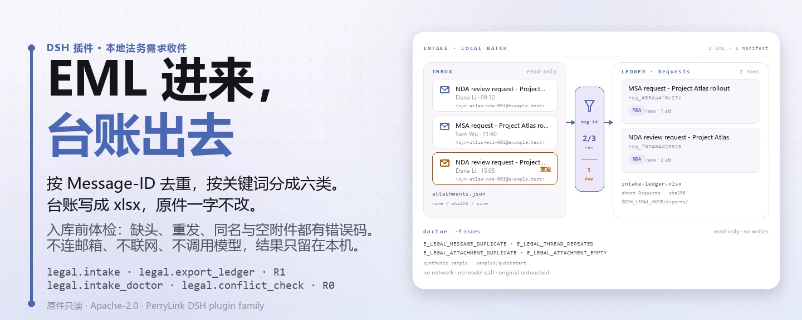
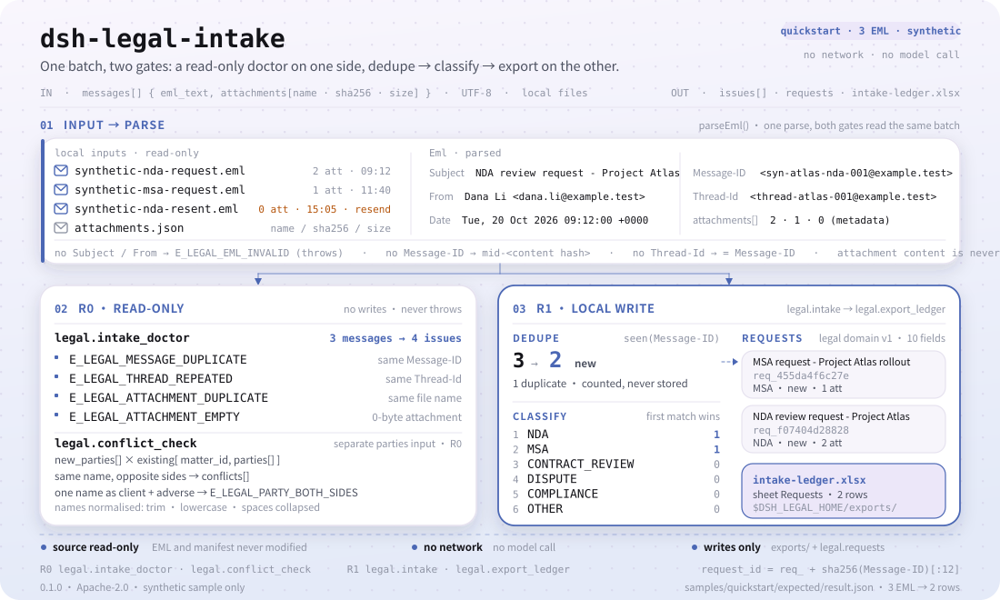
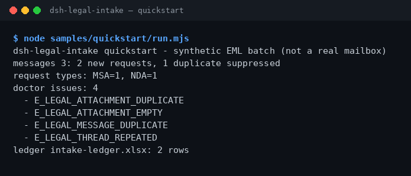

<div align="center">

<picture>
  <source media="(prefers-color-scheme: dark)" srcset="docs/assets/dsh-legal-intake-hero-zh-dark.webp">
  
</picture>

# dsh-legal-intake

**把一封封法务需求邮件变成可复核的本地台账——按线程去重，不联网、不调模型。**

面向 DeepSeek Harness 的本地法务需求收件插件：解析 EML、判断需求类型、按 Message-ID / 线程去重，再导出一份 Excel 台账；原文件只读，所有结果留在本机。

[安装](#三步上手) · [配置](#配置) · [FAQ](#faq) · [简体中文](README.md) · [English](README.en.md) · [Español](README.es.md) · [Português](README.pt.md) · [हिन्दी](README.hi.md)

[](LICENSE)
[](#兼容性)
[](https://www.npmjs.com/package/dsh-legal-intake)
[](https://github.com/PerryLink/dsh-legal-intake/actions/workflows/ci.yml)
[](#兼容性)

[](https://github.com/PerryLink/dsh-legal-intake/stargazers)
[](https://www.npmjs.com/package/dsh-legal-intake)
[](https://dshfind.com/plugins/PerryLink/dsh-legal-intake?ref=badge)
[](https://dsh.market/)
[](https://gitee.com/perrylink/dsh-plugins)

```sh
dsh plugin --profile <profile> add dsh-legal-intake
```

</div>

<sub>社区插件，与 DeepSeek 官方无关。唯一官方仓库：<https://github.com/PerryLink/dsh-legal-intake>（其他账号下的同名仓库与本项目无关；Gitee 为聚合镜像）。状态：alpha · 仅用公开/合成数据验证 · 非 GA——不含客户数据或客户证据，不作生产可用声明。</sub>

## 它是什么

把收到的法务需求 EML 邮件按线程去重、判断需求类型，再导出一份 Excel 台账。插件只在本地工作：你（或会话）把 EML 文本与附件清单交给 `legal_intake`，它解析邮件头、按 `Message-ID` 去重、用关键词把需求归到 `NDA` / `MSA` / `CONTRACT_REVIEW` / `DISPUTE` / `COMPLIANCE` / `OTHER`，并把每条需求写进本地 `legal` 存储域；`legal_export_ledger` 再把这张表导出成 `$DSH_HOME/storages/dsh-legal-intake/exports/intake-ledger.xlsx`。不连邮箱、不联网、不调用模型，原始 EML 与附件清单不会被修改。

- **适合**：几十封客户或供应商发来的 EML 法务需求，需要按 Message-ID / 线程去重，再整理成一份能交给同事复核的台账。
- **不适合**：需要自动连邮箱收信、或需要替你做法律意见与审批结论的场景；本包只在本地读取你给出的文件。

<picture>
  <source media="(prefers-color-scheme: dark)" srcset="docs/assets/dsh-legal-intake-flow-v5-dark.svg">
  
</picture>

## 三步上手

1. **安装**（三选一）：

   ```sh
   # npm 通道（推荐，已发布版本）
   dsh plugin --profile <profile> add dsh-legal-intake
   # git 通道（最新 main；等价于 git+https://github.com/PerryLink/dsh-legal-intake.git）
   dsh plugin --profile <profile> add github:PerryLink/dsh-legal-intake
   # tarball 通道：本仓库 pnpm pack 后
   dsh plugin --profile <profile> add ./dsh-legal-intake-<version>.tgz
   ```

   推荐 npm；其他通道用于固定版本或离线安装。

2. **最小配置**：没有插件级配置键——`cordis.patch.yml` 只 `insert` 一行，默认即可用；需要改的只有环境变量（见「配置」）。

   ```yaml
   - insert:
       - id: dsh-legal-intake
         name: dsh-legal-intake
   ```

3. **验证已生效**：

   ```sh
   dsh --profile <profile> --dump-config | grep dsh-legal-intake
   node samples/quickstart/run.mjs
   ```

   quickstart 读取随包的 3 封合成 EML 与 1 份附件清单，依次调用 `legal_intake_doctor → legal_intake → legal_export_ledger`。在会话里也可以直接说（`package.json` 的 `dsh.demo.prompt`）：

   > 我有一封客户发来的法务需求邮件和附件清单，帮我按线程去重、判断需求类型，再导出一份台账。

   结尾应输出：

```text
dsh-legal-intake quickstart - synthetic EML batch (not a real mailbox)
messages 3: 2 new requests, 1 duplicate suppressed
request types: MSA=1, NDA=1
doctor issues: 4
  - E_LEGAL_ATTACHMENT_DUPLICATE
  - E_LEGAL_ATTACHMENT_EMPTY
  - E_LEGAL_MESSAGE_DUPLICATE
  - E_LEGAL_THREAD_REPEATED
ledger intake-ledger.xlsx: 2 rows
```

**卸载**：`dsh plugin --profile <profile> remove dsh-legal-intake`（或从 profile patch 删掉该行）。

<details>
<summary>从 DSH Desktop 市场安装</summary>

所有 PerryLink 插件均可在 DSH Desktop 内置市场中浏览：**市场 → 来源 → 添加来源 → 粘贴** `https://perrylink-dsh-catalog.perrylink.workers.dev/catalog-source.json` **→ 选中**。安装仍需通过市场的 npm 身份校验与你的确认。

</details>

## 核心能力

- **本地 EML 入库** —— `legal_intake` 接收一批 EML 文本与附件元数据，解析 `Subject` / `From` / `Date` / `Message-ID` / `Thread-Id`，按 `Message-ID` 去重，把新需求写进本地 `legal` 存储域的 `requests` 表；重复邮件只计入「重复」，不产生新行。
- **需求类型分类** —— 按主题与正文的关键词归到 `NDA` / `MSA` / `CONTRACT_REVIEW` / `DISPUTE` / `COMPLIANCE` / `OTHER`；先命中先归类，未命中归 `OTHER`。
- **入库前体检** —— `legal_intake_doctor` 只读检查一批邮件：邮件头缺失、重复 `Message-ID`、重复 `Thread-Id`、同名附件、空文件名、0 字节附件，用稳定错误码报告，不抛异常、不落库。
- **当事人冲突预检** —— `legal_conflict_check` 归一化当事人名称，检查新事项与既有事项之间是否出现「同一当事人站在对立面」，并提示新事项里同一人同时是委托方与对方；只读，不能替代正式的冲突检索。
- **台账导出** —— `legal_export_ledger` 把 `requests` 表导出为 `intake-ledger.xlsx`（工作表 `Requests`），返回路径、行数与文件 SHA-256。
- **纯本地** —— 源码中没有 `fetch` / HTTP / DNS / WebSocket 调用；不连邮箱、OA、云服务，不上传数据。
- **失败可读** —— 错误统一为 `<一句人话>（E_LEGAL_…）｜下一步：<动作>`，按提示就能处理。

### 工具面

工具名是稳定 API（与运行时输出一致，保持英文）；说明已本地化。写文件的工具标 **R1（本地写）**，只读工具标 **R0**。

| 工具 | 用途 | 风险 |
|---|---|---|
| `legal_intake` | 解析 EML、分类需求、按 Message-ID 去重并写入 `requests`；返回新需求 id 与重复 id | R1 本地写 |
| `legal_export_ledger` | 把 `requests` 导出为 `Requests` 工作表，返回路径、行数与 SHA-256 | R1 本地写 |
| `legal_intake_doctor` | 入库前体检：缺头、重复 Message-ID / 线程、同名 / 空名 / 0 字节附件 | R0 只读 |
| `legal_conflict_check` | 新事项与既有事项的当事人冲突预检：归一化名称、对立面、双面当事人 | R0 只读 |

### 输入与输出

输入：

- EML 纯文本（UTF-8）：至少包含 `Subject`、`From`；`Date`、`Message-ID`、`Thread-Id` 可选。缺 `Subject` 或 `From` 报 `E_LEGAL_EML_INVALID`；缺 `Message-ID` 时用内容哈希兜底为 `mid-…`，缺 `Thread-Id` 时回退为 `Message-ID`。
- 附件清单 JSON：每条只写 `name` / `sha256` / `size` 元数据，不读取附件内容本身。
- 自带样例在 `samples/quickstart/input/`：3 封合成 EML + 1 份附件清单，合计远小于 500 KB，随 npm 包发布。
- 工具不设硬性文件上限；建议单批 ≤50 封邮件、附件清单 ≤200 行，便于人工复核。

输出：

- 终端摘要：读了几封、几条新需求、几条重复被跳过、体检发现几个问题。
- 台账：`$DSH_HOME/storages/dsh-legal-intake/exports/intake-ledger.xlsx`，工作表 `Requests`，一行一个需求（`request_id`、`subject`、`from`、`received_at`、`type`、`status`、`attachments`）。
- 请求记录同时写入本地 `legal` 存储域的 `requests` 表；`request_id` 为 `req_` + `Message-ID` 的 SHA-256 前 12 位。
- 原 EML 与附件清单不会被修改。

### 示例

直接复制这句话（`package.json` 里的演示提示词）：

```text
我有一封客户发来的法务需求邮件和附件清单，帮我按线程去重、判断需求类型，再导出一份台账。
```

也可以自己跑（真实运行，截图即来自这条命令）：

```sh
node samples/quickstart/run.mjs
```



*合成 EML → 金标 `samples/quickstart/expected/result.json`；命令与哈希见 `screenshots.json`。*

`--check` 会重新计算并与金标逐字段比对，结尾输出 `quickstart ok`：3 封合成 EML 产生 2 条新需求、1 条去重、4 条体检问题、2 行台账。

*Observed from `samples/quickstart/expected/result.json`（= `node samples/quickstart/run.mjs --json` 的 stdout）；断言见 `test/quickstart.test.mjs`。*

### fixture 支撑的示例

输入：[`fixtures/public/mit/sample_nda.txt`](https://github.com/PerryLink/dsh-legal-intake/blob/main/fixtures/public/mit/sample_nda.txt)（公开 MIT NDA 样本，经 EML 信封由 `test/public-nda-intake.test.mjs` 跑通，分类为 `NDA`）。

命令：`pnpm test`

验收行（对应 `ACCEPTANCE.csv` 的 `SKU-09-A01`，完整 7 行见「实测数据」）：

| req_id | metric | threshold | actual | pass | source | counted |
|---|---|---|---|---|---|---|
| SKU-09-A01 | 邮件入库（50） | 50/50 | 50 | true | public/synthetic | false |

*这是 fixture 支撑的验收行，不是客户运行；没有编造输出。*

## 实测数据

公开 / 合成验收由 `scripts/acceptance.mjs` 重跑，明细落在 `ACCEPTANCE.csv`。以下为其中 7 行（原样引用；完整列含 `script` 与 `evidence_sha256`）：

```csv
req_id,metric,threshold,actual,pass,source,counted
SKU-09-A01,邮件入库（50）,50/50,50,true,public/synthetic,false
SKU-09-A02,线程/Message-ID 去重,5/5,5,true,public/synthetic,false
SKU-09-A03,台账行,50,50,true,public/synthetic,false
SKU-09-A04,台账 sheet,1,1,true,public/synthetic,false
SKU-09-A05,入库前 EML 体检,2,2,true,public/synthetic,false
SKU-09-A06,冲突预检,1,1,true,public/synthetic,false
PS1-QS01,quickstart 样例与金标一致,1/1,1,true,synthetic/quickstart,true
```

`PS1-QS01` 是随包样例的本地复现（`counted=true`）；其余 SKU 行都是公开 / 合成 fixture 检查（`counted=false`）。`EVIDENCE.md` 记录同一批合成数据：0 个真实邮箱，50 封合成 EML + 5 封重发邮件。以上都不是客户运行，没有虚构输出。

公开样例：`samples/quickstart/` 随 npm 包发布，`node samples/quickstart/run.mjs --check` 可复现金标；`fixtures/` 只在仓库内保留（含上面那份 MIT NDA 样本），不在 npm tarball 里。

## 配置

本插件没有 Schemastery 配置键：`cordis.patch.yml` 只 `insert` 一行（`id: dsh-legal-intake`），默认即可用。真正可调的是两个环境变量与工具参数。

| 变量 | 默认值 | 含义 |
|---|---|---|
| `DSH_LEGAL_HOME` | `$DSH_HOME/storages/dsh-legal-intake` | 本地存储与导出目录的基目录；未设 `DSH_HOME` 时退回宿主进程 cwd 下的 `storages/dsh-legal-intake` |
| `DSH_HOME` | 宿主默认 | 上面路径的父目录；测试时可指向一个临时目录，避免写进真实 profile |

最常用的工具参数：

| 参数 | 默认值 | 作用于 | 含义 |
|---|---|---|---|
| `messages[].eml_text` | 必填 | `legal_intake` / `legal_intake_doctor` | UTF-8 EML 全文；需含 `Subject` 与 `From` |
| `messages[].attachments[]` | `[]` | `legal_intake` / `legal_intake_doctor` | 附件元数据 `name` / `sha256` / `size`；不读取附件内容 |
| `new_parties[]` | 必填 | `legal_conflict_check` | 新事项当事人：`name` + `role`（`client` / `adverse`） |
| `existing[]` | 必填 | `legal_conflict_check` | 既有事项：`matter_id` + `parties[]`（同样含 `name` / `role`） |

<details>
<summary>错误码与故障排查</summary>

报错原文都是 `<一句人话>（E_LEGAL_…）｜下一步：<动作>`。常见错误码：

| 错误码 | 何时出现 | 下一步 |
|---|---|---|
| `E_LEGAL_EML_INVALID` | 邮件缺 `Subject` 或 `From`（抛错） | 补上两个邮件头，或先用自带样例 |
| `E_LEGAL_LEDGER_FAILED` | 台账写不出来（`legal_export_ledger` 抛错） | 确认导出目录可写，再重跑一次导出 |
| `E_LEGAL_MESSAGE_DUPLICATE` | 体检发现重复 `Message-ID`（会被当成重发） | 确认是否重发；新需求请让发件人换一封新邮件 |
| `E_LEGAL_THREAD_REPEATED` | 体检发现两封不同邮件用了同一个 `Thread-Id` | 检查线程号，不同串邮件请改成各自线程号 |
| `E_LEGAL_ATTACHMENT_NAME_EMPTY` | 附件清单里有条目没有文件名 | 补上文件名，或删掉该条 |
| `E_LEGAL_ATTACHMENT_DUPLICATE` | 同一封邮件有两个同名附件 | 改成不同文件名，或删掉重复条目 |
| `E_LEGAL_ATTACHMENT_EMPTY` | 附件清单里有 0 字节附件 | 重新上传该附件，或从清单删掉 |
| `E_LEGAL_PARTY_BOTH_SIDES` | 同一当事人在新事项里同时是委托方和对方 | 先确认角色，只保留一边再预检 |

按症状 / 原因 / 动作组织的排查步骤见 [`TROUBLESHOOTING.md`](TROUBLESHOOTING.md)。

</details>

## FAQ

<details>
<summary>装不上怎么办？</summary>

确认 DSH `>=0.2.1-rc.3 <0.4.0`、Node `>=24.9 <25`，并用全新的 `DSH_HOME` 重试；完整步骤见 [`TROUBLESHOOTING.md`](TROUBLESHOOTING.md)。

</details>

<details>
<summary>同一封邮件为什么只入库一次？</summary>

去重按 `Message-ID` 做，同一封重发邮件会被计入「重复」而不是新需求；`legal_intake_doctor` 还会同时提示重复的 `Message-ID` 和重复的 `Thread-Id`。注意：`Thread-Id` 相同但 `Message-ID` 不同的两封邮件不会被去重，只会在体检里报 `E_LEGAL_THREAD_REPEATED`。

</details>

<details>
<summary>附件清单对不上会怎样？</summary>

体检会给出 `E_LEGAL_ATTACHMENT_DUPLICATE`（同名附件）和 `E_LEGAL_ATTACHMENT_EMPTY`（0 字节）；按提示改清单即可，不会改动原附件。

</details>

<details>
<summary>能处理我的真实邮件吗？</summary>

可以本地运行，但本包是 alpha、只用公开/合成数据验证，不构成法律意见；使用真实邮件前请脱敏并保留复核人。

</details>

<details>
<summary>会联网或上传邮件吗？</summary>

不会。解析、去重与导出台账都在本机完成；源码中没有 HTTP / DNS / WebSocket 调用，`package.json` 的演示元数据也声明 `network: false`。

</details>

## 安全边界

- **不联网、不调模型。** 源码中没有 `fetch` / HTTP / DNS / WebSocket 调用；`package.json` 的演示元数据声明 `network: false`。输入和输出都留在本地。
- **输入只读。** 工具接收的是 EML 文本与附件清单 JSON，不读其他目录、不改写原文件；附件只使用 `name` / `sha256` / `size` 元数据，不读取附件内容。
- **写入范围受限。** 写操作只落在 `$DSH_LEGAL_HOME`（缺省 `$DSH_HOME/storages/dsh-legal-intake`）下的 `exports/` 与本地 `legal` 存储域的 `requests` 表。
- **去重保护。** `Message-ID` 已存在于 `requests` 表时，`legal_intake` 只把它计入重复列表，不产生新行、不覆盖既有记录。
- **失败响亮。** 邮件缺头、导出失败都会抛带错误码的异常；体检与冲突预检把问题作为稳定错误码返回，不静默跳过。
- **无隐藏面。** 不去连邮箱 / OA / 云服务，不注册命令、客户端 slot、`webServer` 路由或服务键；宿主只挂 `tools` 与 `storageDomain` 两个服务，没有 R2/R3 工具。

## 权限与数据

- **读**：你指定的 EML 文本与附件清单（由会话读取后作为参数传入）；不读其他目录。
- **写**：`$DSH_HOME/storages/dsh-legal-intake`（`exports/intake-ledger.xlsx`）与本地 `legal` 存储域；不改原文件。
- **联网**：否（源码中没有 HTTP / DNS / WebSocket 调用）。
- **外部系统**：无（不连接邮箱、OA 或云服务，不上传数据）。
- **数据边界**：仅公开 / 合成样例；不含客户数据或客户证据。

写文件的工具标 **R1（本地写）**，只读工具标 **R0**；逐项见「工具面」。

## 已知限制

- **仅公开 / 合成验证。** 所有验收行都来自公开或合成 fixture（`ACCEPTANCE.csv` 中 SKU 行 `counted=false`，`PS1-QS01` 为随包样例本地复现 `counted=true`）；不含客户数据或客户证据。
- **alpha / partial / not counted / 非 GA。** 不作生产可用声明，也不构成法律意见、审批或交易结论。
- **不自动收信。** 不连接邮箱、OA 或云服务；EML 文本与附件清单需由你（或会话）提供。
- **附件只做元数据。** 不解析 docx / pdf 等附件内容；同名、空名与 0 字节附件只作为体检问题报告。
- **EML 是轻量头解析。** 只要求 `Subject` / `From`；不支持 MIME 多部分解码，正文按纯文本处理。缺 `Message-ID` 时以内容哈希兜底，缺 `Thread-Id` 时回退为 `Message-ID`。
- **分类是关键词启发式。** 按 `NDA` → `MSA` → 审查 → 诉讼 → 合规 的顺序先命中先归类，未命中归 `OTHER`，可能误判。
- **去重只按 `Message-ID`。** 同一线程里 `Message-ID` 不同的新邮件不会被去重，只在体检里提示 `E_LEGAL_THREAD_REPEATED`。
- **存储是 JSON KV。** `legal` 域（version 1）只有 `requests` 一张表，没有外键、跨表事务或迁移；`request_id` 由 `Message-ID` 的哈希前 12 位生成。
- **无客户端界面。** 本包是纯 host 形态，不注册 slot / 客户端包；所有操作走工具面。
- **精确边界。** 每个工具的逐项边界以「工具面」表与 `ACCEPTANCE.csv` 为准。

## 与其他 DSH 插件的互操作性

- **工具名带命名空间。** 所有工具都在 `legal_*` 下，不占用内置工具或其他插件的裸名。
- **不抢宿主表面。** 不注册命令、客户端 slot、`webServer` 路由或服务键；只注入 `tools` 与 `storageDomain` 两个宿主服务。
- **存储域独立。** 只使用 `legal`（version 1）这一个域；关闭走 Cordis effect，停止 / 热重载即可撤销。
- **职责互补。** 条款审阅交给 [`dsh-legal-clause`](https://github.com/PerryLink/dsh-legal-clause)，合同全流程交给 [`dsh-contract-suite`](https://github.com/PerryLink/dsh-contract-suite)；条款立场与证据清单分别交给 [`dsh-contract-stance`](https://github.com/PerryLink/dsh-contract-stance) 与 [`dsh-evidence-check`](https://github.com/PerryLink/dsh-evidence-check)。它们各自是独立包，按需安装。

## 兼容性

| 维度 | 状态 |
|---|---|
| Harness | DeepSeek Harness `>=0.2.1-rc.3 <0.4.0`（`package.json` 的 `engines.dsh`） |
| Node | `>=24.9.0 <25`（`.nvmrc`：24） |
| 平台 | 任何 DSH 可运行处；仅本地文件 |
| 数据 | 不联网、不调用模型、不上传 |

## 生态与质量

- [Gitee 聚合镜像](https://gitee.com/perrylink/dsh-plugins)（多个插件同仓归档；以 GitHub 为准）
- [dshfind 插件页](https://dshfind.com/plugins/PerryLink/dsh-legal-intake)（安装量与排名）
- [DSH Market](https://dsh.market/)（已上架）
- **1024 商店渠道**：先 `npm i -g dsh1024`，再 `dsh1024 plugin --profile <profile> add dsh-legal-intake`（计入 [deepseek1024.com](https://deepseek1024.com) 安装排行）
- 文档：[`TROUBLESHOOTING.md`](TROUBLESHOOTING.md) · [`PRIVACY.md`](PRIVACY.md) · [`SECURITY.md`](SECURITY.md) · [`CONTRIBUTING.md`](CONTRIBUTING.md) · [`CHANGELOG.md`](CHANGELOG.md)
- 索引：[领域索引](https://perrylink.github.io/dsh-plugins/) · [Checker 家族](https://perrylink.github.io/zh/checkers/) · [主线家族](https://github.com/PerryLink/dsh-kit)

### 相关项目与核查器

兄弟包与家族索引：[dsh-legal-clause](https://github.com/PerryLink/dsh-legal-clause) · [dsh-contract-suite](https://github.com/PerryLink/dsh-contract-suite)

相关核查器（各自是独立包，带独立规则包与版本；只装需要的）：

| 包 | 为什么相关 |
|---|---|
| [`dsh-contract-stance`](https://github.com/PerryLink/dsh-contract-stance) | 需求进入合同审阅后，用来登记条款立场 |
| [`dsh-evidence-check`](https://github.com/PerryLink/dsh-evidence-check) | 需求演变成争议时，检查证据清单是否完整 |

## 开发

```sh
pnpm install --frozen-lockfile
pnpm build && pnpm lint && pnpm typecheck && pnpm test   # tsc 构建 + node --test（7 个文件 / 14 个用例）
pnpm gate:sku09                                          # 验收门禁（ACCEPTANCE.csv）
node scripts/acceptance.mjs                              # 重跑公开 / 合成验收
node samples/quickstart/run.mjs                          # 合成样例摘要
node samples/quickstart/run.mjs --check                  # 与金标逐字段比对
```

| 路径 | 内容 |
|---|---|
| `src/core/` | EML 解析、需求分类与错误文案（`parseEml` / `classify` / `intakeErrorMessage`） |
| `src/plugin/` | 宿主面：`index.ts` 注册工具，`storage.ts` 定义 `legal` 域，`tools.ts` 四个工具 |
| `lib/` | `tsc` 构建产物，即 npm 发布内容 |
| `samples/quickstart/` | 随包合成样例 + 金标 `expected/result.json` |
| `fixtures/` | 仅仓库保留的公开 fixture（MIT NDA 样本，不在 npm tarball 里） |
| `scripts/` | 构建 / 校验 / 验收脚本与 README 配图生成器 |
| `test/` | `node --test`（7 个文件 / 14 个用例） |

TypeScript 源码在 `src/`，构建产物在 `lib/`。当前仓库版本 `0.2.0`（与 `package.json` 一致）；`node --test test/*.test.mjs` 全绿（7 个文件 / 14 个用例，0 失败）。README 配图由 [`scripts/gen-readme-assets.py`](scripts/gen-readme-assets.py) 程序化生成——hero 横幅用 Pillow 画（`zh`/`en` × 深浅四版），结构图用手写 SVG 画（flow-v5 深浅双版）——可重复执行；旧的单版 `dsh-legal-intake-flow-{light,dark}.svg` 与终端截图保留在 `docs/assets/` 供外链使用，README 只引用新图。

Topics：`deepseek-harness`, `dsh`, `dsh-plugin`, `legal`, `intake`, `contract`, `perrylink`, `eml`

## 家族与致谢

本项目是 [PerryLink](https://github.com/PerryLink) 维护的 DeepSeek Harness 插件家族成员（全部 Apache-2.0）。如果这个插件帮到了你，**给个 star**——它不解锁任何功能，但会让下一个人更容易找到它。

- [@PerryLink](https://github.com/PerryLink) —— 创建者与维护者：EML 解析与线程去重、需求分类、入库前体检、当事人冲突预检、台账导出、quickstart 与验收套件、五语文档。
- 领域家族与主线家族索引：[领域索引](https://perrylink.github.io/dsh-plugins/) · [主线家族](https://github.com/PerryLink/dsh-kit)。

## License

[LICENSE](LICENSE)（Apache License 2.0）© 2026 dsh-legal-intake contributors；另见 `NOTICE` 与 `THIRD-PARTY-NOTICES`。

<p align="center"><sub>Apache-2.0 · 社区插件，与 DeepSeek 无关。</sub></p>
