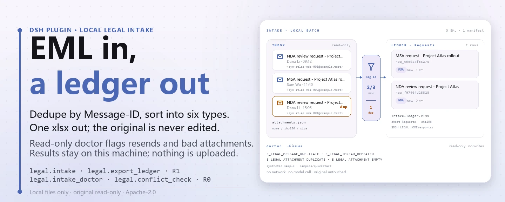
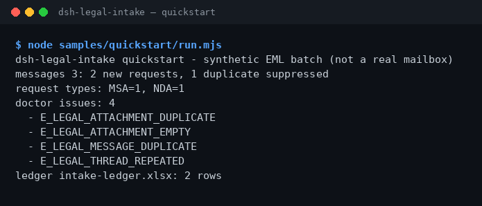

<div align="center">

<picture>
  <source media="(prefers-color-scheme: dark)" srcset="docs/assets/dsh-legal-intake-hero-en-dark.webp">
  
</picture>

# dsh-legal-intake

**Transforme uma pilha de e-mails de solicitações jurídicas em um registro local revisável — deduplicado por thread, sem rede e sem chamar modelo.**

Um plugin local de recepção de solicitações jurídicas para o DeepSeek Harness: analisa EML, classifica o tipo de solicitação, deduplica por Message-ID / thread e exporta um registro Excel. Os originais são somente leitura e todo o resultado fica na sua máquina.

[Instalar](#instalação-em-três-passos) · [Configuração](#configuração) · [FAQ](#faq) · [简体中文](README.md) · [English](README.en.md) · [Español](README.es.md) · [Português](README.pt.md) · [हिन्दी](README.hi.md)

[](LICENSE)
[](#compatibilidade)
[](https://www.npmjs.com/package/dsh-legal-intake)
[](https://github.com/PerryLink/dsh-legal-intake/actions/workflows/ci.yml)
[](#compatibilidade)

[](https://github.com/PerryLink/dsh-legal-intake/stargazers)
[](https://www.npmjs.com/package/dsh-legal-intake)
[](https://dshfind.com/plugins/PerryLink/dsh-legal-intake?ref=badge)
[](https://dsh.market/)
[](https://gitee.com/perrylink/dsh-plugins)

```sh
dsh plugin --profile <profile> add dsh-legal-intake
```

</div>

<sub>Plugin da comunidade, sem afiliação com a DeepSeek. Repositório canônico: <https://github.com/PerryLink/dsh-legal-intake> (repositórios com o mesmo nome em outras contas não são afiliados; o Gitee é um espelho agregado). Estado: alpha · verificado apenas com dados públicos/sintéticos · não GA — sem dados ou evidências de clientes, sem promessa de produção.</sub>

## O que é

Recebe e-mails EML com solicitações jurídicas, deduplica por thread, classifica o tipo de solicitação e exporta um registro Excel. O plugin trabalha apenas na sua máquina: você (ou a sessão) entrega o texto EML e o manifesto de anexos ao `legal.intake`, que analisa os cabeçalhos, deduplica por `Message-ID`, classifica a solicitação em `NDA` / `MSA` / `CONTRACT_REVIEW` / `DISPUTE` / `COMPLIANCE` / `OTHER` por palavras-chave e grava cada solicitação no domínio de armazenamento local `legal`; em seguida `legal.export_ledger` exporta essa tabela para `$DSH_HOME/storages/dsh-legal-intake/exports/intake-ledger.xlsx`. Sem conexão com caixa de correio, sem rede, sem chamada a modelo, e o EML e o manifesto originais nunca são alterados.

- **Serve para**: algumas dezenas de EML com solicitações jurídicas de clientes ou fornecedores que precisam ser deduplicados por Message-ID / thread e virar um registro que um colega possa revisar.
- **Não serve para**: ler uma caixa de correio automaticamente ou emitir opiniões jurídicas e decisões de aprovação por você; o pacote lê apenas os arquivos que você entrega.

<picture>
  <source media="(prefers-color-scheme: dark)" srcset="docs/assets/dsh-legal-intake-flow-v5-dark.svg">
  
</picture>

## Instalação em três passos

1. **Instale** (escolha um canal):

   ```sh
   # canal npm (recomendado; versões publicadas)
   dsh plugin --profile <profile> add dsh-legal-intake
   # canal git (main mais recente; equivalente a git+https://github.com/PerryLink/dsh-legal-intake.git)
   dsh plugin --profile <profile> add github:PerryLink/dsh-legal-intake
   # canal tarball: pnpm pack neste repositório e depois
   dsh plugin --profile <profile> add ./dsh-legal-intake-<version>.tgz
   ```

   O npm é recomendado; os demais canais servem para fixar versão ou instalar offline.

2. **Configuração mínima**: não há chaves de configuração do plugin — o `cordis.patch.yml` apenas `insert`a uma linha e os padrões funcionam. Só as variáveis de ambiente podem precisar de ajuste (ver "Configuração").

   ```yaml
   - insert:
       - id: dsh-legal-intake
         name: dsh-legal-intake
   ```

3. **Verifique que montou**:

   ```sh
   dsh --profile <profile> --dump-config | grep dsh-legal-intake
   node samples/quickstart/run.mjs
   ```

   O quickstart lê os três EML sintéticos e o manifesto de anexos incluídos no pacote e chama, em ordem, `legal.intake_doctor → legal.intake → legal.export_ledger`. Dentro de uma sessão você também pode pedir direto (tradução do prompt de demonstração de `package.json`, `dsh.demo.prompt`):

   > Tenho um e-mail de solicitação jurídica de um cliente e o manifesto de anexos: deduplique por thread, classifique o tipo de solicitação e exporte um registro.

   A saída deve terminar assim:

```text
dsh-legal-intake quickstart - synthetic EML batch (not a real mailbox)
messages 3: 2 new requests, 1 duplicate suppressed
request types: MSA=1, NDA=1
doctor issues: 4
  - E_LEGAL_ATTACHMENT_DUPLICATE
  - E_LEGAL_ATTACHMENT_EMPTY
  - E_LEGAL_MESSAGE_DUPLICATE
  - E_LEGAL_THREAD_REPEATED
ledger intake-ledger.xlsx: 2 rows
```

**Desinstalar**: `dsh plugin --profile <profile> remove dsh-legal-intake` (ou remova a linha do profile patch).

<details>
<summary>Instalar pelo mercado do DSH Desktop</summary>

Todos os plugins PerryLink estão no mercado integrado do DSH Desktop: **Mercado → Fontes → Adicionar fonte → colar** `https://perrylink-dsh-catalog.perrylink.workers.dev/catalog-source.json` **→ selecionar**. A instalação ainda exige a verificação de identidade npm do mercado e a sua confirmação.

</details>

## Recursos principais

- **Recepção local de EML** — `legal.intake` recebe um lote de textos EML e metadados de anexos, analisa `Subject` / `From` / `Date` / `Message-ID` / `Thread-Id`, deduplica por `Message-ID` e grava as solicitações novas na tabela `requests` do domínio local `legal`; um e-mail repetido conta apenas como duplicado e não cria linha nova.
- **Classificação do tipo de solicitação** — classifica por palavras-chave do assunto e do corpo em `NDA` / `MSA` / `CONTRACT_REVIEW` / `DISPUTE` / `COMPLIANCE` / `OTHER`; vence a primeira correspondência e o que não casa vira `OTHER`.
- **Checagem prévia** — `legal.intake_doctor` revisa um lote em somente leitura: cabeçalhos ausentes, `Message-ID` duplicado, `Thread-Id` repetido, nomes de anexo duplicados ou vazios e anexos de 0 byte; devolve códigos estáveis sem lançar exceção nem gravar nada.
- **Pré-checagem de conflitos** — `legal.conflict_check` normaliza nomes de partes, verifica se a mesma parte fica em lados opostos entre um assunto novo e assuntos existentes e avisa quando uma parte aparece nos dois lados do assunto novo; é somente leitura e não substitui uma busca formal de conflitos.
- **Exportação do registro** — `legal.export_ledger` exporta a tabela `requests` para `intake-ledger.xlsx` (planilha `Requests`) e devolve caminho, número de linhas e SHA-256 do arquivo.
- **Totalmente local** — sem chamadas `fetch` / HTTP / DNS / WebSocket no código; não conecta a caixa de correio, OA ou nuvem, e não envia dados.
- **Erros legíveis** — todo erro é `<frase clara> (E_LEGAL_…) | próximo passo: <uma ação>`, para você agir direto.

### Superfície de ferramentas

Os nomes das ferramentas são API estável (coincidem com a saída do runtime e ficam em inglês); as descrições estão localizadas. Ferramentas que gravam são marcadas **R1 (gravação local)** e as somente leitura **R0**.

| Ferramenta | Propósito | Risco |
|---|---|---|
| `legal.intake` | Analisa EML, classifica a solicitação, deduplica por Message-ID e grava `requests`; devolve ids novos e duplicados | R1 gravação local |
| `legal.export_ledger` | Exporta `requests` como planilha `Requests`; devolve caminho, linhas e SHA-256 | R1 gravação local |
| `legal.intake_doctor` | Checagem prévia: cabeçalhos ausentes, Message-ID / thread duplicados, anexos duplicados / vazios / de 0 byte | R0 somente leitura |
| `legal.conflict_check` | Pré-checagem de conflitos entre um assunto novo e assuntos existentes: nomes normalizados, lados opostos, parte nos dois lados | R0 somente leitura |

### Entrada e saída

Entrada:

- Texto EML (UTF-8): no mínimo `Subject` e `From`; `Date`, `Message-ID` e `Thread-Id` são opcionais. Falta de `Subject` ou `From` lança `E_LEGAL_EML_INVALID`; falta de `Message-ID` usa um hash do conteúdo como `mid-…`, e falta de `Thread-Id` usa o `Message-ID`.
- Manifesto de anexos JSON: cada entrada traz apenas metadados `name` / `sha256` / `size`; o conteúdo dos anexos nunca é lido.
- Amostras incluídas em `samples/quickstart/input/`: 3 EML sintéticos + 1 manifesto de anexos, bem abaixo de 500 KB, publicados no pacote npm.
- Não há limite rígido de arquivos; para revisão humana recomendamos no máximo 50 e-mails e 200 linhas de manifesto por lote.

Saída:

- Um resumo no terminal: quantas mensagens foram lidas, quantas solicitações novas, quantos duplicados foram pulados e quantos problemas a checagem prévia encontrou.
- O registro: `$DSH_HOME/storages/dsh-legal-intake/exports/intake-ledger.xlsx`, planilha `Requests`, uma linha por solicitação (`request_id`, `subject`, `from`, `received_at`, `type`, `status`, `attachments`).
- Os registros de solicitação também são gravados na tabela `requests` do domínio local `legal`; `request_id` é `req_` mais os primeiros 12 caracteres hexadecimais do SHA-256 do `Message-ID`.
- O EML original e o manifesto de anexos nunca são alterados.

### Exemplos

Copie esta linha (tradução do prompt de demonstração de `package.json`, `dsh.demo.prompt`):

```text
Tenho um e-mail de solicitação jurídica de um cliente e o manifesto de anexos: deduplique por thread, classifique o tipo de solicitação e exporte um registro.
```

Ou rode você mesmo (execução real: a captura vem deste comando):

```sh
node samples/quickstart/run.mjs
```



*EML sintéticos → arquivo de referência `samples/quickstart/expected/result.json`; o comando e os hashes estão em `screenshots.json`.*

`--check` recalcula e compara campo a campo com o arquivo de referência, terminando com `quickstart ok`: 3 EML sintéticos geram 2 solicitações novas, 1 duplicado, 4 problemas de checagem prévia e 2 linhas de registro.

*Observed from `samples/quickstart/expected/result.json` (= a saída de `node samples/quickstart/run.mjs --json`); as asserções estão em `test/quickstart.test.mjs`.*

### Exemplo com fixture

Entrada: [`fixtures/public/mit/sample_nda.txt`](https://github.com/PerryLink/dsh-legal-intake/blob/main/fixtures/public/mit/sample_nda.txt) (amostra pública de NDA com licença MIT, envolvida em um envelope EML e exercitada por `test/public-nda-intake.test.mjs`; classificada como `NDA`).

Comando: `pnpm test`

Linha de aceitação (a linha `SKU-09-A01` de `ACCEPTANCE.csv`; as sete linhas completas estão em "Dados medidos"):

```csv
req_id,metric,threshold,actual,pass,source,counted
SKU-09-A01,邮件入库（50）,50/50,50,true,public/synthetic,false
```

*É uma linha de aceitação respaldada por fixture, não uma execução de cliente; nenhuma saída é inventada.*

## Dados medidos

A suíte de aceitação pública/sintética é reproduzida com `scripts/acceptance.mjs`; o detalhe está em `ACCEPTANCE.csv`. Estas são as sete linhas, citadas literalmente (o arquivo completo também traz `script` e `evidence_sha256`):

```csv
req_id,metric,threshold,actual,pass,source,counted
SKU-09-A01,邮件入库（50）,50/50,50,true,public/synthetic,false
SKU-09-A02,线程/Message-ID 去重,5/5,5,true,public/synthetic,false
SKU-09-A03,台账行,50,50,true,public/synthetic,false
SKU-09-A04,台账 sheet,1,1,true,public/synthetic,false
SKU-09-A05,入库前 EML 体检,2,2,true,public/synthetic,false
SKU-09-A06,冲突预检,1,1,true,public/synthetic,false
PS1-QS01,quickstart 样例与金标一致,1/1,1,true,synthetic/quickstart,true
```

`PS1-QS01` é uma reprodução local da amostra incluída (`counted=true`); as demais linhas SKU são checagens com fixtures públicas/sintéticas (`counted=false`). O `EVIDENCE.md` registra o mesmo lote sintético: 0 caixas de correio reais, 50 EML sintéticos + 5 mensagens reenviadas. Nada disso é uma execução de cliente e nenhuma saída é inventada.

Amostras públicas: `samples/quickstart/` é publicado no pacote npm e `node samples/quickstart/run.mjs --check` reproduz seu arquivo de referência; `fixtures/` existe apenas no repositório (incluindo a amostra MIT NDA acima) e não faz parte do tarball npm.

## Configuração

Este plugin não tem chaves de configuração Schemastery: o `cordis.patch.yml` apenas `insert`a uma linha (`id: dsh-legal-intake`) e os padrões funcionam. O que você pode ajustar são duas variáveis de ambiente e os argumentos das ferramentas.

| Variável | Padrão | Significado |
|---|---|---|
| `DSH_LEGAL_HOME` | `$DSH_HOME/storages/dsh-legal-intake` | Diretório base do armazenamento local e das exportações; sem `DSH_HOME` cai em `storages/dsh-legal-intake` sob o cwd do processo anfitrião |
| `DSH_HOME` | padrão do host | Diretório pai do caminho acima; em testes aponte para um diretório temporário para não gravar em um perfil real |

Argumentos de ferramenta mais usados:

| Parâmetro | Padrão | Aplica-se a | Significado |
|---|---|---|---|
| `messages[].eml_text` | obrigatório | `legal.intake` / `legal.intake_doctor` | Texto EML completo em UTF-8; precisa conter `Subject` e `From` |
| `messages[].attachments[]` | `[]` | `legal.intake` / `legal.intake_doctor` | Metadados de anexo `name` / `sha256` / `size`; o conteúdo não é lido |
| `new_parties[]` | obrigatório | `legal.conflict_check` | Partes do assunto novo: `name` + `role` (`client` / `adverse`) |
| `existing[]` | obrigatório | `legal.conflict_check` | Assuntos existentes: `matter_id` + `parties[]` (também `name` / `role`) |

<details>
<summary>Códigos de erro e solução de problemas</summary>

Todo erro é lido como `<frase clara> (E_LEGAL_…) | próximo passo: <uma ação>`. Códigos comuns:

| Código | Quando aparece | Próximo passo |
|---|---|---|
| `E_LEGAL_EML_INVALID` | O e-mail não tem `Subject` ou `From` (é lançado) | Acrescente os dois cabeçalhos ou comece pela amostra incluída |
| `E_LEGAL_LEDGER_FAILED` | O registro não pode ser gravado (`legal.export_ledger` lança) | Confirme que o diretório de exportação é gravável e repita |
| `E_LEGAL_MESSAGE_DUPLICATE` | A checagem encontra `Message-ID` duplicado (tratado como reenvio) | Confirme se é reenvio; para solicitação nova peça um e-mail novo |
| `E_LEGAL_THREAD_REPEATED` | Dois e-mails diferentes compartilham um `Thread-Id` | Revise o id da thread; cadeias não relacionadas precisam de ids próprios |
| `E_LEGAL_ATTACHMENT_NAME_EMPTY` | Uma entrada do manifesto não tem nome de arquivo | Acrescente o nome ou remova a entrada |
| `E_LEGAL_ATTACHMENT_DUPLICATE` | Um e-mail tem dois anexos com o mesmo nome | Dê nomes diferentes ou remova o duplicado |
| `E_LEGAL_ATTACHMENT_EMPTY` | Uma entrada do manifesto é um anexo de 0 byte | Reenvie o anexo ou remova-o do manifesto |
| `E_LEGAL_PARTY_BOTH_SIDES` | Uma parte é cliente e adversa ao mesmo tempo no assunto novo | Confirme o papel e deixe só um lado antes de repetir |

Os passos por sintoma / causa / ação estão em [`TROUBLESHOOTING.md`](TROUBLESHOOTING.md).

</details>

## FAQ

<details>
<summary>Não instala — e agora?</summary>

Confirme DSH `>=0.2.1-rc.3 <0.4.0` e Node `>=24.9 <25`, e tente de novo com um `DSH_HOME` novo; os passos completos estão em [`TROUBLESHOOTING.md`](TROUBLESHOOTING.md).

</details>

<details>
<summary>Por que o mesmo e-mail entra só uma vez?</summary>

A deduplicação é por `Message-ID`, então um e-mail reenviado conta como duplicado em vez de solicitação nova; o `legal.intake_doctor` também avisa sobre `Message-ID` duplicados e `Thread-Id` repetidos. Atenção: dois e-mails com o mesmo `Thread-Id` mas `Message-ID` diferente não são deduplicados; a checagem apenas informa `E_LEGAL_THREAD_REPEATED`.

</details>

<details>
<summary>O que acontece se o manifesto de anexos não bater?</summary>

A checagem devolve `E_LEGAL_ATTACHMENT_DUPLICATE` (mesmo nome) e `E_LEGAL_ATTACHMENT_EMPTY` (0 byte); corrija o manifesto conforme a sugestão — os anexos originais não são tocados.

</details>

<details>
<summary>Dá para processar meus e-mails reais?</summary>

Roda localmente, mas o pacote é alpha e verificado apenas com dados públicos/sintéticos; não constitui opinião jurídica. Anonimize os e-mails reais antes de usar e mantenha um revisor humano.

</details>

<details>
<summary>Ele acessa a rede ou envia e-mails?</summary>

Não. A análise, a deduplicação e a exportação do registro acontecem na sua máquina; o código não tem chamadas HTTP / DNS / WebSocket e os metadados de demonstração do `package.json` declaram `network: false`.

</details>

## Limites de segurança

- **Sem rede e sem chamada a modelo.** O código não contém chamadas `fetch` / HTTP / DNS / WebSocket; os metadados de demonstração do `package.json` declaram `network: false`. Entrada e saída ficam locais.
- **Entrada somente leitura.** As ferramentas recebem texto EML e um JSON de manifesto, não leem outros diretórios e nunca reescrevem um original; dos anexos usam apenas metadados `name` / `sha256` / `size`.
- **Gravações limitadas.** As gravações caem apenas sob `$DSH_LEGAL_HOME` (padrão `$DSH_HOME/storages/dsh-legal-intake`) em `exports/` e na tabela `requests` do domínio local `legal`.
- **Proteção contra duplicados.** Se um `Message-ID` já existe na tabela `requests`, o `legal.intake` apenas o conta como duplicado: nem linha nova, nem sobrescrita.
- **Falhas barulhentas.** Cabeçalhos ausentes e falhas de exportação lançam erros com código; a checagem prévia e a pré-checagem de conflitos devolvem códigos estáveis em vez de pular em silêncio.
- **Sem superfície oculta.** Sem conexão com caixa de correio / OA / nuvem e sem registrar comandos, slots de cliente, rotas `webServer` ou chaves de serviço; o host monta apenas `tools` e `storageDomain`, sem ferramentas R2/R3.

## Permissões e dados

- **Leitura**: o texto EML e o manifesto de anexos que você indicar (a sessão lê e passa como argumentos); nenhum outro diretório.
- **Gravação**: `$DSH_HOME/storages/dsh-legal-intake` (`exports/intake-ledger.xlsx`) e o domínio local `legal`; os arquivos originais não são tocados.
- **Rede**: não (sem chamadas HTTP / DNS / WebSocket no código).
- **Sistemas externos**: nenhum (sem caixa de correio, OA ou nuvem; sem envio).
- **Fronteira de dados**: apenas amostras públicas/sintéticas; sem dados ou evidências de clientes.

Ferramentas que gravam são marcadas **R1 (gravação local)** e as somente leitura **R0**; ver "Superfície de ferramentas".

## Limitações conhecidas

- **Verificado apenas com dados públicos/sintéticos.** Todas as linhas de aceitação vêm de fixtures públicas ou sintéticas (`counted=false` nas linhas SKU de `ACCEPTANCE.csv`; `PS1-QS01` é uma reprodução local da amostra com `counted=true`); sem dados ou evidências de clientes.
- **Alpha / parcial / não contabilizado / não GA.** Sem promessa de produção e sem conclusão jurídica, de aprovação ou de transação.
- **Sem leitura automática da caixa de correio.** Não conecta a caixas, OA ou nuvem; o texto EML e o manifesto precisam ser fornecidos por você (ou pela sessão).
- **Anexos apenas como metadados.** Não analisa conteúdo docx / pdf nem de outros anexos; anexos duplicados, sem nome ou de 0 byte são apenas reportados como problemas de checagem prévia.
- **Análise EML leve.** Só `Subject` / `From` são exigidos; não há decodificação MIME multipart e o corpo é tratado como texto simples. Sem `Message-ID`, usa-se um hash do conteúdo; sem `Thread-Id`, usa-se o `Message-ID`.
- **Classificação por palavras-chave.** Tenta `NDA` → `MSA` → revisão → disputa → conformidade em ordem e fica com a primeira correspondência, caindo em `OTHER`; pode errar.
- **Deduplicação só por `Message-ID`.** Um e-mail novo da mesma thread com outro `Message-ID` não é deduplicado; a checagem apenas informa `E_LEGAL_THREAD_REPEATED`.
- **Armazenamento JSON KV.** O domínio `legal` (version 1) tem uma única tabela `requests`, sem chaves estrangeiras, transações entre tabelas ou migrações; `request_id` vem dos primeiros 12 caracteres hexadecimais do hash do `Message-ID`.
- **Sem interface de cliente.** O pacote é somente host e não registra slots nem pacotes de cliente; tudo passa pela superfície de ferramentas.
- **Limites exatos.** Os limites por ferramenta são exatamente a tabela "Superfície de ferramentas" mais `ACCEPTANCE.csv`.

## Interoperabilidade com outros plugins do DSH

- **Nomes de ferramenta com namespace.** Todas as ferramentas ficam sob `legal.*` e não ocupam nomes nus de ferramentas embutidas ou de outros plugins.
- **Não ocupa superfícies do host.** Não registra comandos, slots de cliente, rotas `webServer` ou chaves de serviço; apenas injeta os serviços `tools` e `storageDomain`.
- **Domínio de armazenamento independente.** Usa um único domínio, `legal` (version 1); o encerramento é um effect do Cordis, então parar ou recarregar o plugin o desfaz.
- **Responsabilidades complementares.** A revisão de cláusulas fica com [`dsh-legal-clause`](https://github.com/PerryLink/dsh-legal-clause) e o fluxo contratual completo com [`dsh-contract-suite`](https://github.com/PerryLink/dsh-contract-suite); postura de cláusulas e listas de evidência ficam com [`dsh-contract-stance`](https://github.com/PerryLink/dsh-contract-stance) e [`dsh-evidence-check`](https://github.com/PerryLink/dsh-evidence-check). Cada um é um pacote separado, instalado só quando necessário.

## Compatibilidade

| Superfície | Estado |
|---|---|
| Harness | DeepSeek Harness `>=0.2.1-rc.3 <0.4.0` (`engines.dsh` do `package.json`) |
| Node | `>=24.9.0 <25` (`.nvmrc`: 24) |
| Plataformas | Onde o DSH rodar; apenas arquivos locais |
| Dados | Sem rede, sem chamada a modelo, sem envio |

## Ecossistema e qualidade

- [Espelho agregado no Gitee](https://gitee.com/perrylink/dsh-plugins) (vários plugins arquivados juntos; o GitHub é a referência)
- [Página do plugin no dshfind](https://dshfind.com/plugins/PerryLink/dsh-legal-intake) (instalações e ranking)
- [DSH Market](https://dsh.market/) (listado)
- **Canal da loja 1024**: `npm i -g dsh1024` uma vez e depois `dsh1024 plugin --profile <profile> add dsh-legal-intake` (conta para o ranking de instalações do [deepseek1024.com](https://deepseek1024.com))
- Documentação: [`TROUBLESHOOTING.md`](TROUBLESHOOTING.md) · [`PRIVACY.md`](PRIVACY.md) · [`SECURITY.md`](SECURITY.md) · [`CONTRIBUTING.md`](CONTRIBUTING.md) · [`CHANGELOG.md`](CHANGELOG.md)
- Índices: [Índice de domínio](https://perrylink.github.io/dsh-plugins/) · [Família de checkers](https://perrylink.github.io/zh/checkers/) · [Família principal](https://github.com/PerryLink/dsh-kit)

### Trabalho relacionado e verificadores

Pacotes irmãos e índices de família: [dsh-legal-clause](https://github.com/PerryLink/dsh-legal-clause) · [dsh-contract-suite](https://github.com/PerryLink/dsh-contract-suite)

Cada verificador é um pacote separado com seu próprio rule pack e versão; instale só os que precisar:

| Pacote | Por que é relevante |
|---|---|
| [`dsh-contract-stance`](https://github.com/PerryLink/dsh-contract-stance) | Registro de postura de cláusulas quando a recepção vira revisão de contrato |
| [`dsh-evidence-check`](https://github.com/PerryLink/dsh-evidence-check) | Completude da lista de evidências quando a solicitação vira disputa |

## Desenvolvimento

```sh
pnpm install --frozen-lockfile
pnpm build && pnpm lint && pnpm typecheck && pnpm test   # build tsc + node --test (6 arquivos / 13 casos)
pnpm gate:sku09                                          # portão de aceitação (ACCEPTANCE.csv)
node scripts/acceptance.mjs                              # repetir a aceitação pública/sintética
node samples/quickstart/run.mjs                          # resumo da amostra sintética
node samples/quickstart/run.mjs --check                  # comparar campo a campo com o arquivo de referência
```

| Caminho | Conteúdo |
|---|---|
| `src/core/` | Análise EML, classificação de solicitações e textos de erro (`parseEml` / `classify` / `intakeErrorMessage`) |
| `src/plugin/` | Face host: `index.ts` registra as ferramentas, `storage.ts` define o domínio `legal`, `tools.ts` contém as quatro ferramentas |
| `lib/` | Saída do `tsc`, ou seja, o conteúdo publicado no npm |
| `samples/quickstart/` | Amostra sintética incluída + arquivo de referência `expected/result.json` |
| `fixtures/` | Fixtures públicas apenas do repositório (a amostra MIT NDA; não estão no tarball npm) |
| `scripts/` | Scripts de build / verificação / aceitação e o gerador de imagens do README |
| `test/` | `node --test` (6 arquivos / 13 casos) |

O código TypeScript fica em `src/` e a saída de build em `lib/`. Versão atual do repositório `0.1.0` (coincide com o `package.json`); `node --test test/*.test.mjs` passa (6 arquivos / 13 casos, 0 falhas). As imagens do README são geradas programaticamente por [`scripts/gen-readme-assets.py`](scripts/gen-readme-assets.py) — o banner hero com Pillow (quatro arquivos, zh/en × claro/escuro) e o diagrama de estrutura como SVG escrito à mão (flow-v5 claro e escuro) — e é seguro executar de novo; o antigo `dsh-legal-intake-flow-{light,dark}.svg` de versão única e as capturas de terminal ficam em `docs/assets/` para os links existentes, enquanto os READMEs referenciam apenas as imagens novas.

Topics: `deepseek-harness`, `dsh`, `dsh-plugin`, `legal`, `intake`, `contract`, `perrylink`, `eml`

## Família e agradecimentos

Este projeto faz parte da família de plugins do DeepSeek Harness mantida pela [PerryLink](https://github.com/PerryLink) (todos Apache-2.0). Se for útil, **uma estrela ajuda a próxima pessoa a encontrá-lo** — nada fica bloqueado por trás dela.

- [@PerryLink](https://github.com/PerryLink) — criador e mantenedor: análise EML e deduplicação por thread, classificação de solicitações, checagem prévia, pré-checagem de conflitos, exportação do registro, a suíte de quickstart e aceitação, e a documentação em cinco idiomas.
- Índices da família de domínio e principal: [Índice de domínio](https://perrylink.github.io/dsh-plugins/) · [Família principal](https://github.com/PerryLink/dsh-kit).

## Licença

[LICENSE](LICENSE) (Apache License 2.0) © 2026 dsh-legal-intake contributors; veja também `NOTICE` e `THIRD-PARTY-NOTICES`.

<p align="center"><sub>Apache-2.0 · Plugin da comunidade, sem afiliação com a DeepSeek.</sub></p>
